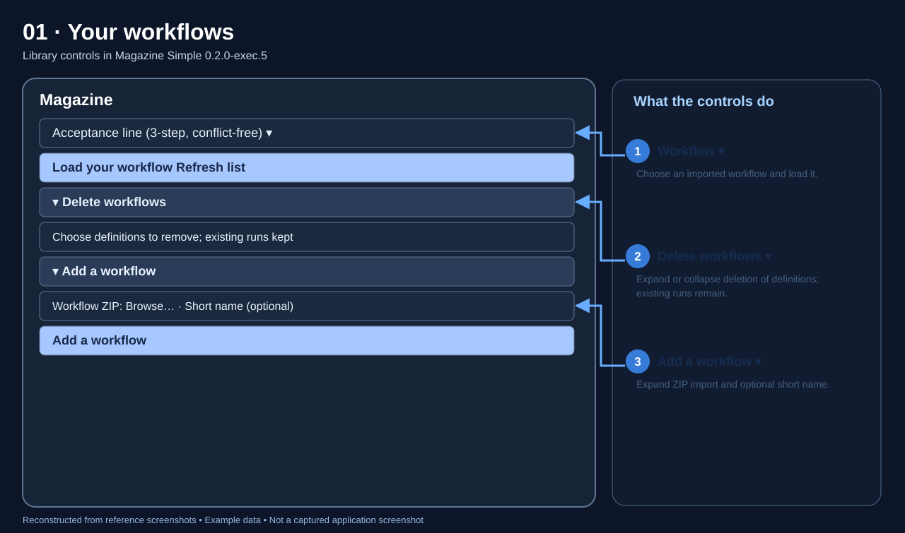
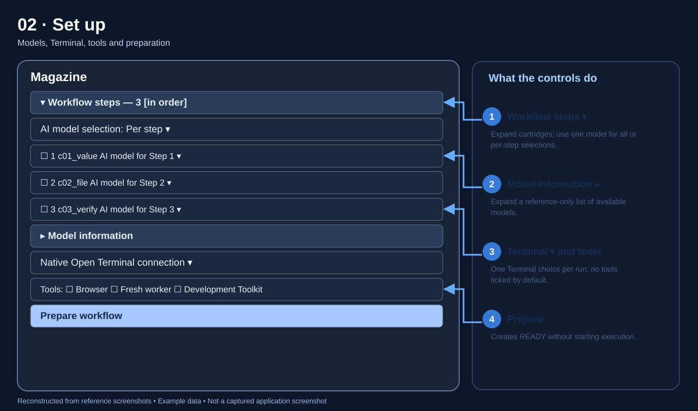
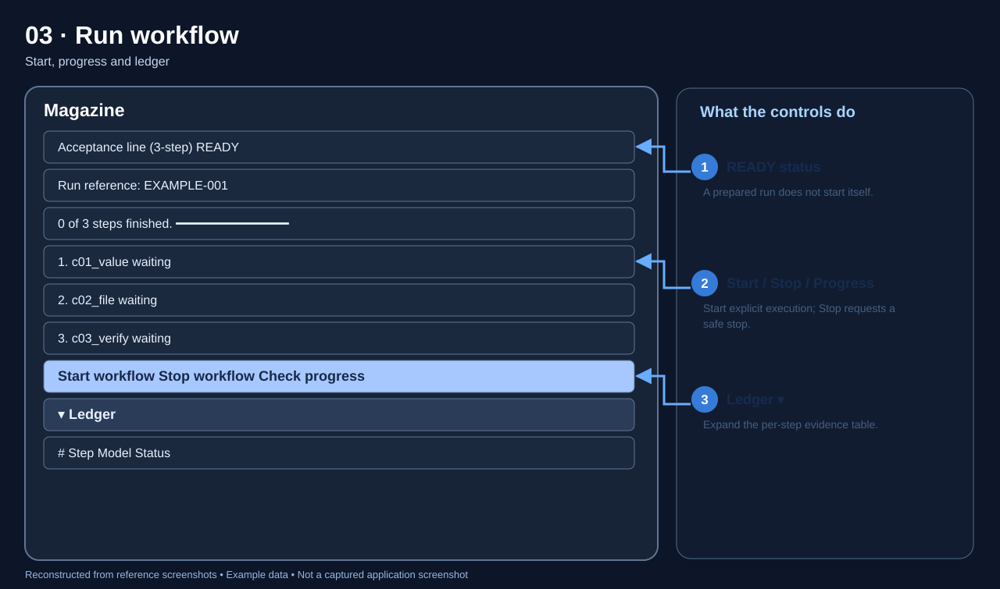
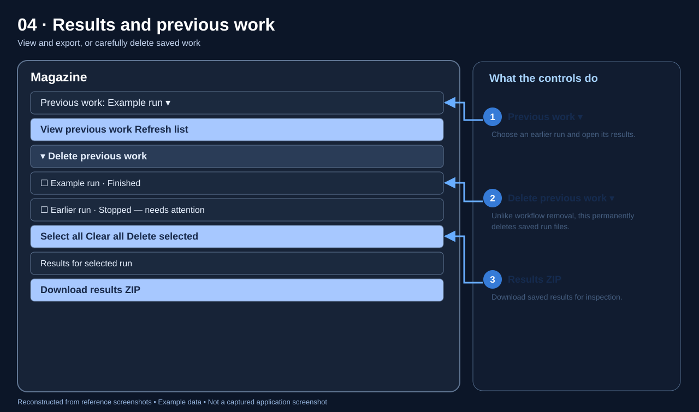
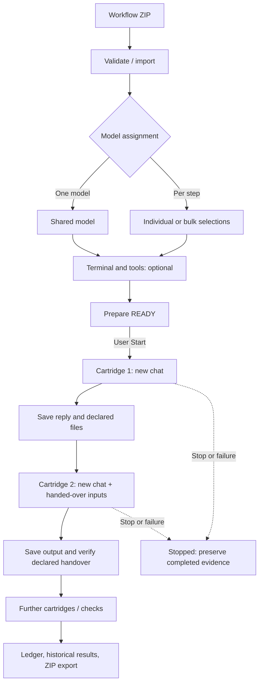

# Magazine

**Magazine Simple 0.2.0-exec.5** is the latest **locally installed** Open WebUI version, verified on **13 November 2026**. The separate **Sidebar Launcher 0.1.0** is installed for navigation on Open WebUI **0.12.5**.

> **Publication note:** The source and downloadable runner package currently in this repository are still the **older Magazine 0.1.0-beta.5** edition. This documentation update does **not** publish the exec.5 runner or turn the older package into exec.5. Read the version distinction below before installing.

## What is Magazine?

Magazine helps smaller, locally hosted language models tackle larger projects by **splitting work into manageable, prewritten tasks** called *cartridges*. Each step gets a fresh chat with its assigned AI model. Magazine runs the steps in order, records the results and can pass explicitly declared files to the next step.

For example, one model might create a file, a second examine it and a third check the result. You choose the models and tools; Magazine handles the sequence. This does **not** make a model inherently more capable, guarantee correctness or write the plan automatically. It makes a complex workflow easier to organise and inspect.

## The current interface

The new **Magazine Simple** page lives at **`/magazine-simple`**. The sidebar launcher adds a Magazine link that opens this page in a new tab.

**[Explore the complete annotated HTML interface](docs/guide/index.html)** · [Technical installation and test record](docs/SIMPLE_0.2.0_EXEC5.md)

The guide is a generic reconstruction from the latest installed UI screenshots, with numbered arrows explaining all major dropdowns and expandable sections. It is **documentation**, not a separate installation or a copy of the actual user data. The images below show the guide sections individually to keep the page readable.

<strong>See the illustrated controls (4 sections)</strong>

### 1. Your workflows

### 2. Set up

### 3. Run workflow

### 4. Results and previous work

The main controls are straightforward: **Add or load a workflow → choose models → choose Terminal and tools if needed → Prepare workflow → Start workflow → review the ledger and download results.** Preparation does not execute any model.

## How it works

The number of cartridges is set by the workflow, not fixed at three or twenty. Individual steps can use different models or share the same one. Optional tools remain subject to Open WebUI and model permissions. A step labelled **Finished** means it ran and its result was saved; check the result before trusting it.

## Versions and installation

| Component | Status | What to know |
| --- | --- | --- |
| **Magazine Simple 0.2.0-exec.5** | **Installed and live-tested locally, 13 Nov 2026** | New streamlined Open WebUI runner at `/magazine-simple`. Its full installable source has **not been published in this repository**. |
| **Magazine Simple Sidebar Launcher 0.1.0** | **Installed separately** | Targets Open WebUI 0.12.5, adds a new-tab link to `/magazine-simple`. [Source](integrations/open_webui/function/magazine_simple_sidebar_launcher.py) · [How it works](docs/SIDEBAR_LAUNCHER.md). |
| **Magazine 0.1.0-beta.5** | **Current public runner download** | Older Open WebUI Function-only edition, accepted against Open WebUI 0.11.3 and served at `/magazine`. [Installation guide](docs/FUNCTION_INSTALL.md) · [Download](downloads/Magazine-0.1.0-beta.5-FunctionOnly.zip). |
| **Pi Web UI edition** | Separate project path | [Pi guide](pi-web-ui/README.md) · [Pi installation notes](pi-web-ui/INSTALL.md). Do not install Open WebUI Functions into Pi. |

**Already running exec.5?** Keep your installed Function and data intact. The older beta.5 download is **not** an update for it.

The older customised Open WebUI Docker sidebar recipe is preserved under [integrations/open_webui/frontend](integrations/open_webui/frontend/README.md) but remains on security/licensing distribution HOLD. It is a different integration from the current lightweight Sidebar Launcher; don't install both just to add one menu link.

## What the latest test established

The **13 November 2026 exec.5 acceptance line** ran **three real cartridges to completion** with `qwen3-coder-udq4-native:latest`, Open Terminal and no extra tools. Steps 2 and 3 made actual Terminal calls. The declared file handover was checked and the verification result reported **`match: true`**. The live step-2 output exercised the **inline DONE** completion path.

The in-place update preserved all **178 pre-existing run files** byte-for-byte. The previous-work deletion interface was examined in Chromium, but **actual deletion was not performed**. Firefox interactions and Open WebUI container logs were not verified.

This is credible *specific* acceptance evidence, not a general benchmark proving all workflows work. [Read the detailed record](docs/SIMPLE_0.2.0_EXEC5.md).

### Historical evidence is kept separate

The older public **beta.5** acceptance recorded **989 automated passing regressions** (611 core, 244 Function and 134 UI/sidebar). Earlier beta.4 live Bonsai and STOP checks also remain documented. These are useful historical baselines, **not** rerun exec.5 tests.

[Historical test summary](docs/TESTING.md) · [Beta.5 acceptance](docs/ACCEPTANCE.md) · [Changelog](CHANGELOG.md)

<strong>For coders and engineers — architecture, evidence and constraints</strong>

Magazine is an **executor for bounded prompts**, not an autonomous planner. The workflow author is responsible for decomposing the work and specifying inputs, outputs and declared file handovers.

The Open WebUI Function is an integration with the host's model/tool access. The Simple Launcher is **only** a menu-link publisher, which modifies the host's static `loader.js` and retains backups. Review the [launcher notes](docs/SIDEBAR_LAUNCHER.md) before installing it elsewhere.

For implementation and acceptance boundaries, see [exec.5 details](docs/SIMPLE_0.2.0_EXEC5.md), [security](docs/SECURITY.md), [legacy STOP semantics](docs/STOP.md) and [historical limitations](docs/LIMITATIONS.md). Older beta.5 storage/recovery internals should **not** be assumed to describe exec.5 without checking its current code.

The current repo does not contain the locally installed exec.5 runner's verified 111,367-byte Function source; do not infer source parity or create a release from screenshots.

## Licence and safety

Magazine is released under the [MIT licence](LICENSE). Open WebUI, third-party models and other dependencies retain their own licensing terms. Review any imported workflow and the permissions of tools you enable. A finished workflow or successful tool call is not proof that its outputs are safe or correct.

[Security notes](docs/SECURITY.md) · [Licensing](docs/LICENSING.md) · [Repository history](CHANGELOG.md)
