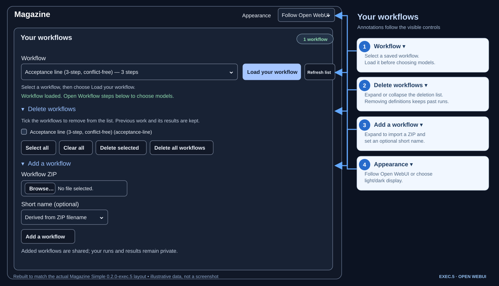
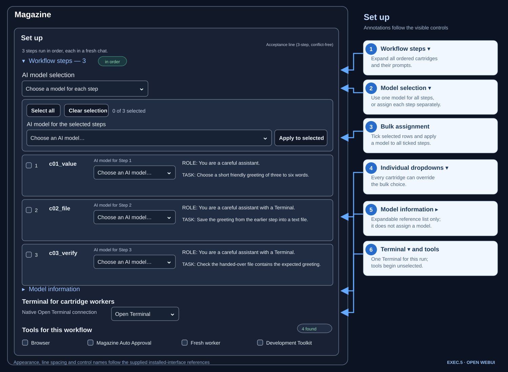
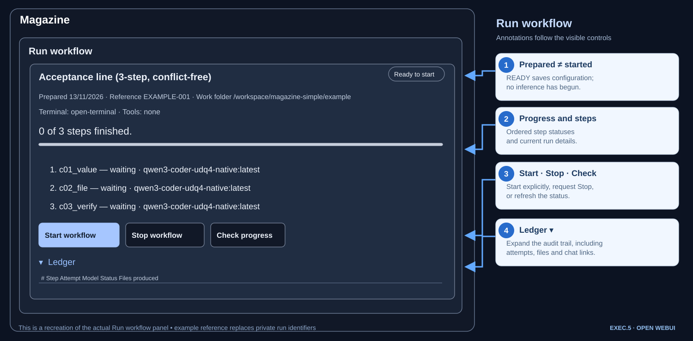
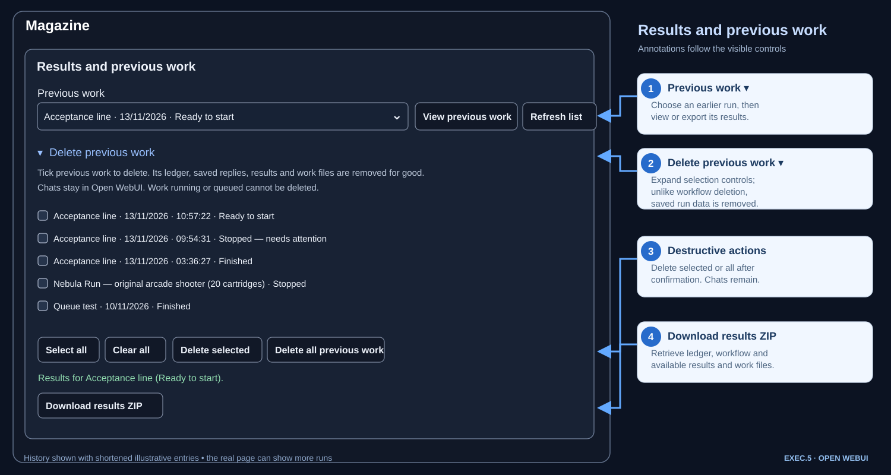
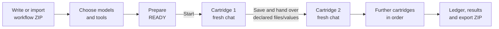

# Magazine

**A simple workflow runner for local AI models.**

Magazine helps smaller language models tackle larger projects by breaking the work into **prewritten, manageable tasks** called *cartridges*. Each cartridge gets a fresh Open WebUI chat with its assigned model. Magazine executes them in order, preserves the work and passes along declared files or values when the next step needs them.

The idea is straightforward: let the model concentrate on **one job at a time**, while Magazine handles the sequence. Magazine does not plan the project for you, automatically repair mistakes, or guarantee a correct result.

**Current local version:** **Magazine Simple 0.2.0-exec.5** on Open WebUI **0.12.5** (13 November 2026). **Sidebar Launcher:** **0.1.0**, installed separately.

## This is what Magazine looks like

*Recreated directly from the supplied 13 November 2026 interface references, using the real layout and control names. The sample workflow and run details are illustrative; this is not a live screenshot.*

**[Explore the complete visual walkthrough](docs/guide/index.html)** — with interactive model-selection examples and explanations of the controls.

### Set up: choose models, Terminal and tools

Expand **Workflow steps** to inspect the cartridges. Choose **one model for all steps** or **a model for each step**, with bulk selection when needed. The **Model information** section is only a reference list. Select a Terminal if the workflow needs one, and tick only the tools required; tools start unticked.

### Run: prepare first, start separately

**Prepare workflow** creates a READY run; it does not start any model. **Start workflow** begins execution, **Check progress** refreshes the status and **Ledger** expands the per-step record. **Stop** is not a pause button. If a run fails or stops, the operator can choose **Continue from this step** when earlier cartridges have completed.

### Results and previous work

You can inspect earlier runs, keep their evidence and export a ZIP. **Delete workflows** removes imported definitions but keeps past runs; **Delete previous work** removes the selected saved run data, while leaving its Open WebUI chats intact. The live delete operation was **not** part of the exec.5 acceptance test.

## How the workflow works

A workflow can contain as many cartridges as its author designs, subject to practical limits. Cartridges can use the same model or different models. Declared file handovers are checked against recorded hashes; saved replies and Open WebUI chats remain available for inspection. **Finished** means execution completed and the result was stored, **not** that every answer was correct.

## Versions and files

| Component | Version | Availability |
| --- | --- | --- |
| **Magazine Simple runner** | **0.2.0-exec.5** | [Exact installed-source file](integrations/open_webui/function/magazine_simple_exec5.py) now published for inspection and development. Locally installed and live-tested; **no separately verified public installer or clean-install acceptance**. Page: `/magazine-simple`. |
| **Simple Sidebar Launcher** | **0.1.0** | [Separate launcher source](integrations/open_webui/function/magazine_simple_sidebar_launcher.py). Adds a link opening `/magazine-simple` in a new tab on the tested Open WebUI 0.12.5 host; it does **not** run cartridges. |
| **Earlier Magazine Function** | 0.1.0-beta.5 | [Historical Function-only ZIP](downloads/Magazine-0.1.0-beta.5-FunctionOnly.zip) for its accepted Open WebUI 0.11.3 baseline, at `/magazine`. **Not an exec.5 update.** |
| **Pi Web UI edition** | Separate development path | [Pi notes](pi-web-ui/README.md). Open WebUI Functions cannot be installed in Pi directly. |

The original Docker-patched sidebar integration remains in [the historical source](integrations/open_webui/frontend/README.md) for future reference. Its custom Docker image is **not** an approved public binary release. Do not confuse that integration with the current independent Sidebar Launcher.

### What has actually been tested?

On **13 November 2026**, the local exec.5 update preserved **178 existing run files** with identical hashes. A live **three-cartridge acceptance workflow** finished with Qwen3 Coder, Open Terminal calls in steps 2 and 3, a verified file handover and a `match: true` result. The inline `{"status":"DONE"}` completion case was exercised.

The previous-work deletion interface was checked in Chromium, but no live deletion was carried out. Firefox interactions and the container logs were not verified.

The earlier beta.5 version had **989 passing automated regression tests**. These remain valid *historical* results; they were **not rerun on exec.5**.

[Full exec.5 acceptance evidence and limitations](docs/SIMPLE_0.2.0_EXEC5.md) · [Historical testing](docs/TESTING.md) · [Changelog](CHANGELOG.md)

<strong>For coders and engineers — technical details</strong>

Magazine Simple is a native Open WebUI **Event Function** that registers a page and authenticated `/api/magazine-simple` endpoints. It creates fresh chats through Open WebUI's usual APIs and reads the saved assistant result. The engine uses a **single active run per Python process** with an **in-memory FIFO queue** (not a distributed lock).

The default completion rule requires a closing `{"status":"DONE"}` and any declared outputs. A model can return `{"status":"HALT","reason":"..."}`. There is **no automatic retry, planning, review, compaction or inference time limit**. A human can restart from a cartridge if all earlier ones finished.

Saved runs are **owner-scoped**, while the **workflow library is shared** and any authenticated user can import or delete workflow definitions. Files are passed using explicit `artifacts.inputs`/`artifacts.outputs`, with source-byte SHA-256 verification. The normal output includes `LEDGER.md`, saved prompts/replies, workflow details and a results ZIP.

The exact [exec.5 source](integrations/open_webui/function/magazine_simple_exec5.py) is 111,367 bytes and matches the local installed SHA-256:
`400f8bf4739bac012ce5c0036eb0ecbcf098695e2a9726a00eef84df934d1309`.

**[Read the engineering reference](docs/SIMPLE_0.2.0_EXEC5.md)** for API routes, storage layout, YAML examples, limits, completion parsing, stop/restart semantics, queue durability, valves, security boundaries and verification evidence.

## Licence and safety

Magazine is published under the [MIT licence](LICENSE). Open WebUI and other software retain their own licences. Review workflows and selected tools before running them. For the latest Simple version, source identity and one local acceptance workflow have been verified; no broader production-readiness certification is claimed.

[Security notes](docs/SECURITY.md) · [Sidebar Launcher details](docs/SIDEBAR_LAUNCHER.md) · [Illustrated guide](docs/guide/index.html)
