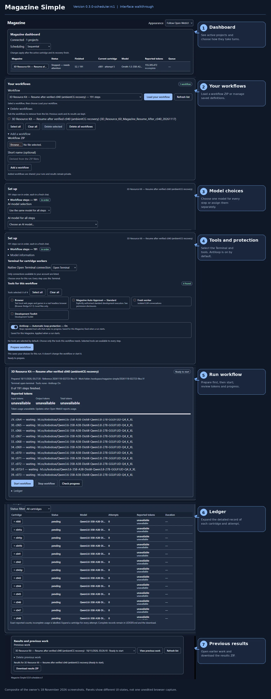

# Magazine Simple

**Make bigger projects manageable for your local AI.**

Magazine is a workflow runner for [Open WebUI](https://github.com/open-webui/open-webui). It splits a project into smaller jobs called **cartridges**. Each cartridge runs in a fresh chat with the model you choose. Magazine keeps the order, saves the work, and passes verified results to the next job.

You plan the jobs; Magazine runs them. It does not invent a plan or guarantee the AI's work is correct.

**Latest installed and source-verified version:** **0.3.0-scheduler.rc1** (18 November 2026), tested with **Open WebUI 0.12.5**. This is a **release candidate**, not a general production certification.

[**Download latest source ZIP**](downloads/Magazine-Simple-0.3.0-scheduler.rc1-source.zip) · [**Exact Function source**](integrations/open_webui/function/magazine_simple_scheduler_rc1.py) · [**How to use Magazine**](docs/USING_MAGAZINE.md) · [**Technical details**](docs/TECHNICAL_0.3.0_SCHEDULER_RC1.md) · [**Changelog**](CHANGELOG.md)

## The interface

*Built from the owner's actual 18 November 2026 screenshots, with arrows and short explanations. Different expanded/collapsed states are arranged vertically to make one readable walkthrough; it is **not** an unedited single browser capture.*

## What's new in 0.3.0

- **More than one project:** the dashboard shows each project's status, current cartridge, model, token reporting and position in the queue.
- **Two scheduling choices:** **Sequential** finishes one project before starting the next. **Round Robin** gives projects turns, switching after each completed and verified cartridge. Only **one cartridge runs at a time**.
- **Better return to previous work:** reopening the page restores saved run details instead of looking like an empty, new session. Interrupted work is retained, but it does **not restart itself**.
- **Clearer ledger:** six overview columns, expandable attempt details, status filters, reported tokens and duration.
- **Safer stopping and recovery:** a stopped project stays stopped, earlier verified work is preserved and failures are recorded without silently replaying completed cartridges.

The existing **Antiloop** protection, **five-attempt maximum**, **1,800 seconds per fresh chat**, checked file handovers and results ZIP remain part of Magazine. The new scheduler has passed isolated tests; several live multi-project and service-restart scenarios still need real-world acceptance.

[See exactly what changed and what was tested](docs/TECHNICAL_0.3.0_SCHEDULER_RC1.md).

## Get started

1. **Import a workflow ZIP** using **Add a workflow**. This ZIP contains the job instructions, not the Magazine software.
2. **Load the workflow** and choose a model for every cartridge (or one model for all).
3. **Choose a Terminal and any tools** that the work actually needs. Tools are unticked by default.
4. Select **Prepare workflow** to create a ready-to-run job. This **does not start** your AI.
5. Select **Start workflow**. Watch progress in the dashboard and ledger, then download the results ZIP.

If a run stops, inspect the recorded reason. You can continue from an eligible cartridge without deleting earlier results. This is not a guarantee that unfinished code is correct.

[Step-by-step guide](docs/USING_MAGAZINE.md)

## Install or update Magazine Simple

The repository includes the exact source of the version installed on Open WebUI 0.12.5:

**[Download source ZIP](downloads/Magazine-Simple-0.3.0-scheduler.rc1-source.zip)** or read [the versioned Function source](integrations/open_webui/function/magazine_simple_scheduler_rc1.py).

Make a backup and ensure the scheduler has no active or queued work before updating. In **Open WebUI → Admin Panel → Functions**, edit the existing **Magazine Simple** Function and replace its source, keeping its Function identity and settings. Save, then open **`/magazine-simple`**.

**Do not** upload the Function source or a source-release ZIP using **Add a workflow**: that control is for cartridge workflows only. The **Sidebar Launcher 0.1.0** is separate and unchanged.

For requirements, a source checksum, recovery behaviour, security notes and testing limitations, see the [technical guide](docs/TECHNICAL_0.3.0_SCHEDULER_RC1.md).

## What Magazine can — and cannot — promise

Magazine can run and record a planned sequence, check declared handover files, retain evidence, make limited recovery attempts and prevent several known failure modes. It **cannot** guarantee that a model wrote correct code, that a service will survive every outage, or that two models can safely edit the same project folder at once. Review workflows before giving them a Terminal or powerful tools.

Older Function versions, experiments and evidence remain in the repository for reference. For an earlier visual demonstration, see the [historical November interface guide](docs/guide/index.html), which is not a screenshot of the latest release.

## Licence

Magazine is released under the [MIT licence](LICENSE). Open WebUI, models and connected tools have their own licences.
