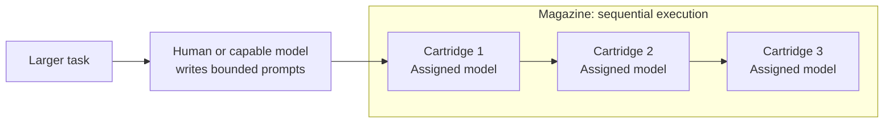
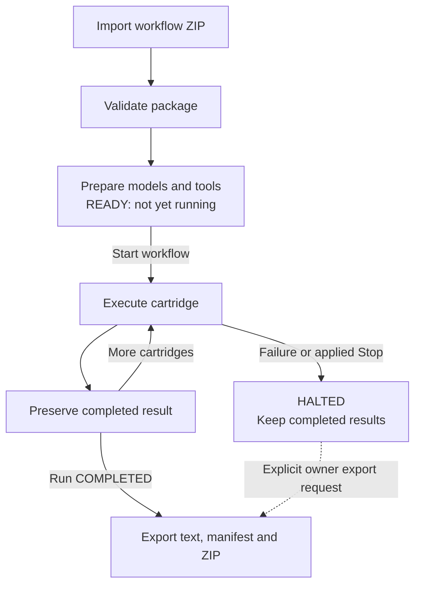
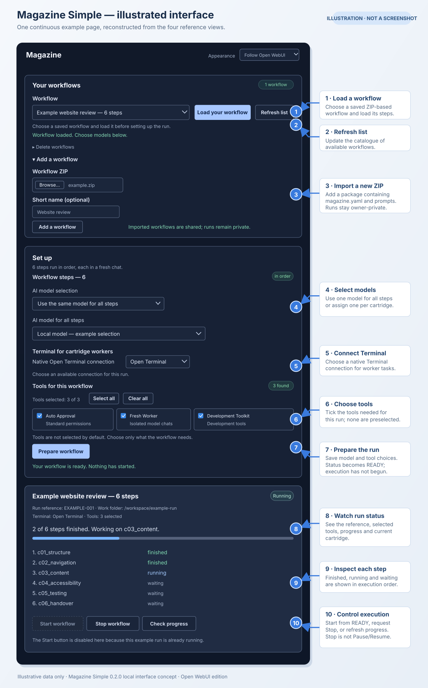
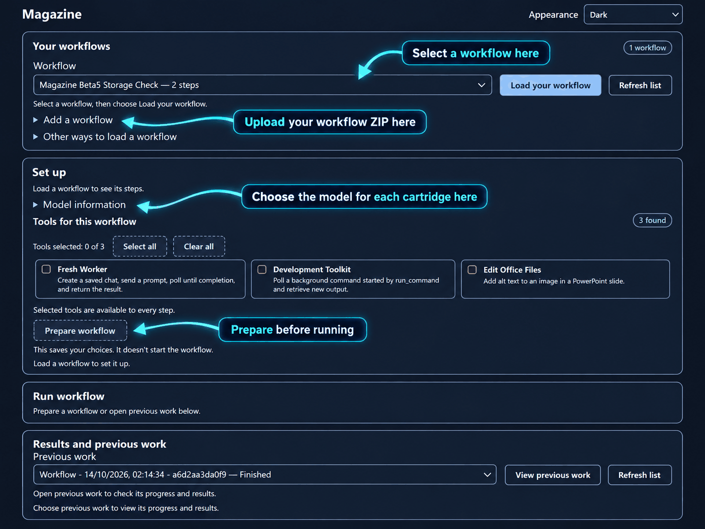
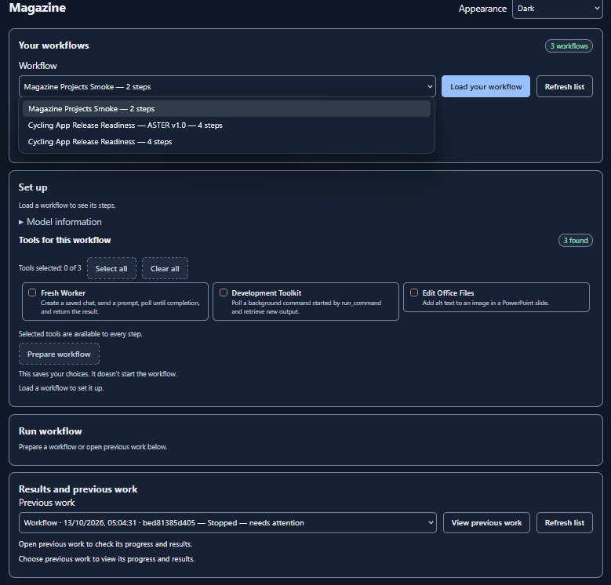

# Magazine

> **Development status — 2 November 2026.** The maintainer's current local installation is **0.1.0-beta.10-rc.2** on Open WebUI **0.12.5**, with a separate **Magazine Sidebar Launcher 0.1.0**. That verified local baseline is frozen for an isolated efficiency/cleanup pass; the live installation and local LLMs are in use and are not available for development tests. **The public source and download instructions below are still beta.5**, not the installed RC2 build. See the [frozen-baseline and optimisation brief](docs/OPTIMISATION_BASELINE_2026-11-02.md) for provenance, test isolation and acceptance requirements.

> **Interface update — 11 November 2026.** The [combined illustration](#magazine-simple-020-illustrated-local-interface) below reconstructs the maintainer's newer **Magazine Simple 0.2.0** local Open WebUI page from four reference views. It uses fictional sample data, numbered arrows and explanations; none of the original screenshots is displayed. This is a UI guide, **not** a claim that the public beta.5 Function or frozen beta.10 RC2 build provides these controls. The published source/download remains beta.5 until a separate release.

**v0.1.0-beta.5 — Beta / Proof of Concept**

## Choose your Magazine edition

Magazine is available in two versions for different chat interfaces. **Choose the one that matches what you already use.**

| Your interface | Start here |
| --- | --- |
| **Open WebUI** | You're in the right place. The instructions below describe the **0.1.0-beta.5 Open WebUI edition**. [Jump to installation](#install-the-open-webui-function). |
| **Pi Web UI** | [Read the Pi edition guide](pi-web-ui/README.md) · [Pi installation instructions](pi-web-ui/INSTALL.md). The Pi prerelease download is being prepared; it is **not yet available** in this repository. |

### Open WebUI sidebar: two different implementations

Both sidebar implementations add a **navigation link** to `/magazine`. Neither is the Magazine cartridge runner, and clicking the link does not start a workflow.

| Sidebar implementation | How it works | Version and availability |
| --- | --- | --- |
| **Legacy Docker-image sidebar** | Builds a customised Open WebUI frontend with a [sidebar patch and Dockerfile](integrations/open_webui/frontend/README.md). The Magazine Function is imported separately. | Pinned to **Open WebUI 0.11.3 / Magazine beta.5**. The source recipe is in this repository, but image distribution remains on **security/licensing HOLD**. It is **not** validated for 0.12.5. |
| **New independent Sidebar Launcher 0.1.0 Function** | Adds the sidebar entry through the existing Open WebUI static loader. Does **not** replace the Docker image or change the cartridge runner. | Tested on the maintainer's local **Open WebUI 0.12.5 / Magazine beta.10 RC2**. The launcher source is **not yet published in this repository**. |
| **Function-only beta.5 installation** | Opens Magazine directly at `/magazine` with no sidebar modification. | The currently published beta.5 installation path, accepted for **Open WebUI 0.11.3**. |

The old Docker sidebar remains in the repository for potential future work. These are **alternative navigation integrations**, not two install steps to combine. See the [optimisation baseline](docs/OPTIMISATION_BASELINE_2026-11-02.md) for the preserved current setup.

Both editions execute independently prepared tasks called *cartridges*, but they have **different installers and compatibility requirements**. Don't install an Open WebUI Function package into Pi or a Pi plugin into Open WebUI.

---

Magazine runs prewritten LLM tasks called *cartridges*, one at a time. Each task runs in a fresh temporary conversation with its assigned model. Magazine records the result before proceeding to the next task. The Open WebUI and Pi editions have separate installation instructions.

I built Magazine to investigate whether smaller, locally hosted language models
can undertake more complicated work when it's divided into manageable tasks.
A long agentic prompt may ask a model to solve a problem while managing the
overall plan and extensive instructions. That can be a lot to handle at once.

Magazine keeps control of the sequence outside the model. A human or a more
capable model writes the bounded tasks; Magazine executes them using your
assigned models. The worker can concentrate on one task rather than the project.

This doesn't make the model more intelligent. The approach may also suit larger
models, but no comparative benchmark establishes performance improvements for
either. Magazine is an execution system, not an automatic planner: good prompts
and sensible task decomposition still matter.

Magazine is still a beta prototype. The current version demonstrates the core
approach, and additional features are planned as development continues.

## How it works

In the currently published **beta.5** implementation, each cartridge runs in a fresh Open WebUI conversation without inherited parent history. It attempts to remove the temporary chat after preserving its result; the arrows above show execution order, **not** file handover. The newer, locally tested **Magazine Simple 0.2.0** keeps worker chats and supports explicit file handover between dependent cartridges in `magazine.yaml`. Its workflow page is illustrated below.

Choose one available model for the workflow or assign models to individual
cartridges. Selected tools are passed through Open WebUI at run level, subject
to its permissions and the model's capabilities. Magazine doesn't provision
tools or grant additional access.

The interface separates preparation from execution. You import and validate a
package, review its prompts, choose models and tools, then prepare a **READY**
run. Nothing starts until you choose **Start workflow**.

Results are saved before the next cartridge starts. **COMPLETED** means the
workflow finished executing and its responses were saved; it does not mean
those responses are factually correct or that the real-world task succeeded.
You'll still need to review the work and run any relevant external checks.

## Magazine Simple 0.2.0 — illustrated local interface

The picture below combines the four reference views into **one continuous example of the Magazine page**, in the same order as the controls appear: workflow library, model selection, Terminal and tools, followed by run monitoring. It is an **illustration reconstructed from the current local UI**, not a screenshot. The example workflow name, six cartridges, model, run reference and progress are fictional. The actual available models, tools and cartridge count depend on your installation and imported workflow.

### What the numbered arrows mean

1. **Load a workflow:** Select a saved workflow and choose **Load your workflow** to inspect its steps.
2. **Refresh list:** Update the catalogue of available imported workflows.
3. **Import a workflow:** Open **Add a workflow**, select a ZIP containing `magazine.yaml` and its referenced prompts, then add it. Imported workflows are shared; individual runs and results remain private to their owner.
4. **Choose AI models:** Apply one model to the whole run or assign a different model to individual cartridges.
5. **Select Terminal:** Choose an available **Native Open Terminal** connection for cartridge workers.
6. **Choose tools:** Enable the tools this run needs. Magazine does **not** select them by default, and tool availability still depends on Open WebUI permissions.
7. **Prepare workflow:** Save the model and tool choices. The run becomes **READY**; no cartridge has started.
8. **Watch progress:** Once started, see the run reference, work folder, selected connections and completion count.
9. **Inspect step status:** Cartridges appear in order with states such as waiting, running and finished. A finished result still needs independent review for correctness.
10. **Control execution:** **Start workflow** begins a READY run; **Stop workflow** requests a safe stop; **Check progress** refreshes the status. Stop is not Pause/Resume.

**Typical flow:** Add or choose workflow → Load → Choose models → Select Terminal and tools → Prepare → Start → Check progress or Stop.

The illustration documents the newer local **Simple 0.2.0** interface. It is **not** the installation experience of the public beta.5 package described below.

#### Historical beta.5 interface

*Historical beta.5 illustration. [Unannotated image](docs/screenshots/magazine-interface-original.png). The published beta.5 installation instructions below remain separate from the Simple 0.2.0 preview above.*

## A practical example

Suppose you want to review a small Python function before using it in a project.
Instead of asking for a broad review in one prompt, you could write these
cartridges, including the same source excerpt in each:

| Cartridge | Bounded task |
| --- | --- |
| Input handling | Identify accepted inputs and cases that could produce unexpected behaviour. Refer to specific lines. |
| Error handling | Inspect the function's failure paths. Explain whether errors are handled or left to the caller. |
| Test preparation | Suggest concrete test cases for the supplied function, including edge cases. Don't claim to have executed them. |

Read these independent inspections together; the third cartridge doesn't
receive the first two answers. Magazine doesn't load your repository into
the prompts for you.

The [two-cartridge example](examples/simple/magazine.yaml) uses a fixed-reply
prompt and an independent arithmetic question to check execution and routing,
not answer correctness. Keep `magazine.yaml` at the root of a workflow ZIP,
alongside its referenced prompts.

## Install the Open WebUI Function

Use the **Function-only integration** with **Open WebUI 0.11.3**. Other versions
haven't been accepted. You'll need administrator access, authentication enabled,
persistent data storage and a working model through your existing Open WebUI
connections, such as Ollama or an OpenAI-compatible provider.

1. Back up your data and any existing Magazine Function. Review the
   [source](integrations/open_webui/function/magazine_ef.py): Functions execute
   Python with server privileges.
2. Download and extract the [beta.5 Function-only package](downloads/Magazine-0.1.0-beta.5-FunctionOnly.zip).
3. Open **Admin Panel → Functions → Create menu → Import JSON**. Import
   `integrations/open_webui/function/magazine-function.json` and enable **Magazine**.
4. Visit `/magazine` on your Open WebUI server, for example
   `http://localhost:3000/magazine`, and bookmark it.

Installation starts no workflows and adds no permanent sidebar button.
Keep your existing Open WebUI image. The [installation guide](docs/FUNCTION_INSTALL.md)
covers updates, backup, rollback and removal.

*Magazine interface during local beta.4 testing. The Function-only installation opens at `/magazine` without adding a sidebar button.*

## Everyday use

Check that your account can use the model in an ordinary Open WebUI chat.
An administrator imports a ZIP into the shared library. Choose **Load your
workflow**, review its cartridges and select models and tools.

Choose **Prepare workflow**, inspect the READY run, then choose **Start workflow**.
**Check progress** shows status and responses; **View previous work** opens
earlier runs without restarting them.

**Stop workflow** preserves completed results and prevents later cartridges
from starting once Stop takes effect. If active inference cancellation can't
be confirmed, the current cartridge may finish before the workflow stops at
the next safe boundary. If the final cartridge finishes first, the run may
remain COMPLETED. An eligible failure-halted run can be prepared to
continue through explicit recovery, which does not itself start execution.
A run with a durable Stop request cannot use that recovery path; Stop is not
Pause/Resume. See [STOP and recovery behaviour](docs/STOP.md).

## Input ZIPs and Finished Work

Beta.5 separates original packages from finished outputs:

- **Input-ZIPs** retains an exact copy of a successfully imported workflow ZIP.
  Placing other ZIPs in that folder doesn't import them.
- **Finished-Work** contains saved cartridge text, a machine-readable manifest
  and `results.zip`, organised by owner, project and run. COMPLETED runs export
  automatically; HALTED runs' completed portions require an explicit owner request.

Defaults are `DATA_DIR/magazine/input-zips/` and `DATA_DIR/magazine/finished-work/`.
Optional Docker bind mounts expose host folders, such as
`C:\AI_Workflows\Magazine\Input-ZIPs` and `C:\AI_Workflows\Magazine\Finished-Work`.
The server-side settings are `MAGAZINE_INPUT_ZIPS_DIR` and
`MAGAZINE_FINISHED_WORK_DIR`.

Read responses in Magazine or open the ZIP in Finished Work. Internal history
and recovery records stay in `DATA_DIR/magazine/runs/`. Export retries don't
overwrite unrelated work; storage failures are reported without discarding
canonical results. [Storage setup](docs/STORAGE.md) covers Windows/Linux mounts,
retrieval, permissions and backups. Retain the existing data volume and
deployment settings when adding mounts.

## Testing and evidence

**Magazine Simple 0.2.0 (current local interface):** The illustrated workflow page documents what the maintainer has shown in Open WebUI: importing or loading a workflow, choosing models and tools, preparing a run, and viewing execution progress. It is an interface demonstration, not an independent acceptance test. **No automated test total or release-wide acceptance claim is established here for Simple 0.2.0.**

**Earlier beta.5 (published source):** Its regression results belong to that older implementation and should not be taken as evidence for Simple 0.2.0. The archived [beta.5 testing summary](docs/TESTING.md), [acceptance report](docs/ACCEPTANCE.md) and [validation instructions](docs/VALIDATION.md) remain available for anyone evaluating the published beta.5 package.

## Current limitations

- In the **published beta.5** build, prompts must be self-contained and earlier results aren't automatically injected into later cartridges. The newer local Simple 0.2.0 can hand over declared files, but does not automatically guarantee task correctness, planning, repair or model substitution.
- The tested deployment is a single Linux backend, including Docker Desktop
  on Windows. Multi-worker/Redis deployments and proxy path prefixes aren't accepted.
- Finished Work exports only the canonical cartridge text Magazine possesses,
  not separate Development Toolkit files or reconstructed chat archives.
- A backend interruption can leave export work incomplete. The documented
  retry/manual-inspection process is separate from execution recovery; no
  automatic resume or historical ZIP backfill is performed.

For a more detailed explanation, see [current limitations](docs/LIMITATIONS.md).

## Security, licence and repository guide

Use trusted packages and review tool permissions. Magazine doesn't patch or
certify your Open WebUI host's security. Read the
[security notes](docs/SECURITY.md) before using it with untrusted inputs.

Magazine uses the [MIT licence](LICENSE); Open WebUI and its dependencies retain
their own licences. See [licensing](docs/LICENSING.md). The customised sidebar
image remains on **security and licensing distribution HOLD**, separate from
the public Function-only route. Its [source recipe](docs/INSTALL.md) is for
review, not an approved binary release.

`magazine/` contains the independent execution core;
`integrations/open_webui/function/` contains the native Function and interface.
`examples/simple/` holds the small workflow; `tests/` and integration tests hold
the regression suites. [Changelog](CHANGELOG.md) and [release notes](docs/RELEASE_NOTES.md) summarise beta.5.
