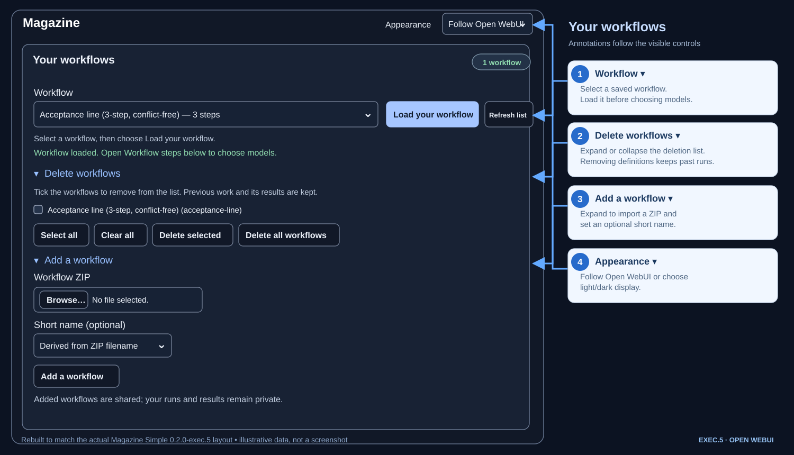
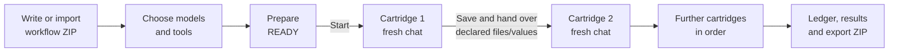

# Magazine

**A simple workflow runner for local AI models.**

Magazine helps smaller language models tackle larger projects by breaking the work into **prewritten, manageable tasks** called *cartridges*. Each cartridge gets a fresh Open WebUI chat with its assigned model. Magazine executes them in order, preserves the work and passes along declared files or values when the next step needs them.

The idea is straightforward: let the model concentrate on **one job at a time**, while Magazine handles the sequence. Magazine does not plan the project or judge whether a model's work is correct. The current runner can make **bounded, targeted recovery attempts** when publication or eligible output-file steps fail; those retries do not guarantee a correct result.

**Current locally installed version:** **Magazine Simple 0.2.0-handover.1** on Open WebUI **0.12.5** (15 November 2026). **Sidebar Launcher:** **0.1.0**, separately installed and unchanged. This page documents a verified *local update*; a separate public clean-install acceptance has not been reported.

## This is what Magazine looks like



*Recreated directly from the supplied 13 November 2026 interface references, using the real layout and control names. The sample workflow and run details are illustrative; this is not a live screenshot.*

**[Explore the complete visual walkthrough](docs/guide/index.html)** — with interactive model-selection examples and explanations of the controls.

### Set up: choose models, Terminal and tools


Expand **Workflow steps** to inspect the cartridges. Choose **one model for all steps** or **a model for each step**, with bulk selection when needed. The **Model information** section is only a reference list. Select a Terminal if the workflow needs one, and tick only the tools required; tools start unticked.

### Run: prepare first, start separately


**Prepare workflow** creates a READY run; it does not start any model. **Start workflow** begins execution, **Check progress** refreshes the status and **Ledger** expands the per-step record. **Stop** is not a pause button. If a run fails or stops, the operator can choose **Continue from this step** when earlier cartridges have completed.

### Results and previous work


You can inspect earlier runs, keep their evidence and export a ZIP. **Delete workflows** removes imported definitions but keeps past runs; **Delete previous work** removes the selected saved run data, while leaving its Open WebUI chats intact. The live delete operation was **not** part of the exec.5 acceptance test.

## How the workflow works



A workflow can contain as many cartridges as its author designs, subject to practical limits. Cartridges can use the same model or different models. In newly prepared runs, file-based results are checked and committed before downstream cartridges begin; original Open WebUI chats remain available for inspection. **Finished** means execution completed and the results were stored, **not** that every answer was correct.

## New: verified file handover and bounded recovery (15 November 2026)

Magazine Simple **0.2.0-handover.1** is installed in the existing Open WebUI Function. It keeps the same cartridge workflow and page while strengthening the handover between fresh chats:

- **Attempt-scoped results:** a standard-library Python publisher writes a result file tied to the run, cartridge, attempt and saved chat. The model no longer needs to reproduce an entire handover JSON object accurately in its final chat text.
- **Verification before handover:** Magazine requires DONE, checks declared files and outgoing selectors, validates result identity and commits accepted data with SHA-256 checks and a read-back. The next cartridge rechecks the committed evidence.
- **Complete attempt evidence:** original saved chats, including tool calls/results, are archived with hashes and included in downloaded result ZIPs.
- **Targeted automatic recovery:** missing/invalid result publication can trigger a fresh verification chat; eligible staged-file failures can trigger a fresh repair chat. The defaults are **at most two fresh model retries per cartridge within 900 seconds**, plus up to two transient-storage retries. Repeated failures without verified progress stop earlier.
- **Safe boundaries:** explicit HALT, Stop, identity/integrity failures, exhausted budgets and incomplete commits stop the affected run. There is no automatic crash resume, task replanning or model substitution. Tasks without declared staged outputs cannot be given automatic edit-repair attempts.

**Existing saved runs are kept in legacy compatibility mode**, not silently converted. The failed 3D Resource Kit run was preserved without being restarted. Workflow authors can select `handover_mode: legacy_chat` for compatibility or configure bounded recovery in `magazine.yaml`.

[Technical details and recovery options](docs/SIMPLE_0.2.0_HANDOVER1.md) · [New acceptance evidence](docs/TESTING.md)

## Real-world test: 72-cartridge game build (14 November 2026)

Magazine Simple **0.2.0-exec.5** completed a full **72-cartridge** local-model workflow to build *Nebula Run v3 — Stage 1: Cinder Reach*, a browser-based horizontal shooter. The retained Open WebUI **0.12.5** run records **72/72 cartridges done, with one attempt each**, using **Bonsai 2 27B** and Open Terminal. The recorded run lasted **1 hour 59 minutes 39 seconds** (00:23:49–02:23:28 UTC; approximately two hours). The workflow produced a **7.3 MB game ZIP** with verified Magazine file handovers.

The generated game's test suite reported **64 passes, 0 failures**; a software-canvas visual gate passed; and a simulated playthrough reached stage clear. The operator subsequently **confirmed the game ran in Firefox**. The runner itself recorded the browser check as **NOT TESTED**, so this is a user-confirmed desktop execution, not an automated Firefox compatibility or playability certification.

This demonstrates substantial real-world multi-cartridge execution and a runnable game deliverable, **not** perfect game quality or guaranteed success on other projects. The final audit also retained **one expected-file hash mismatch** in an enemy-art script despite passing tests.

**[Read the full evidence, run configuration and limitations](docs/REAL_WORLD_GAME_RUN_2026-11-14.md).** This run used **exec.5**, not the later handover.1 version. It remains valuable historical evidence, not a handover.1 acceptance run.

## Versions, source and release boundaries

| Component | Version | Availability |
| --- | --- | --- |
| **Magazine Simple runner (current local installation)** | **0.2.0-handover.1** | Installed and live-tested on Open WebUI 0.12.5. The supplied release bundle contains source and tests, but **its new source is not yet published as a repository file or independently accepted as a public clean-install package**. See [engineering notes](docs/SIMPLE_0.2.0_HANDOVER1.md). Page: `/magazine-simple`. |
| **Earlier Simple runner (historical source)** | **0.2.0-exec.5** | [Source as installed on 13 November](integrations/open_webui/function/magazine_simple_exec5.py), preserved for inspection. **Not** the newly installed handover.1 code. [Older engineering reference](docs/SIMPLE_0.2.0_EXEC5.md). |
| **Simple Sidebar Launcher** | **0.1.0** | [Separate launcher source](integrations/open_webui/function/magazine_simple_sidebar_launcher.py). Adds a link opening `/magazine-simple` on the tested Open WebUI 0.12.5 host; it does **not** execute cartridges. |
| **Earlier Magazine Function** | **0.1.0-beta.5** | [Historical Function-only ZIP](downloads/Magazine-0.1.0-beta.5-FunctionOnly.zip), accepted against Open WebUI 0.11.3, at `/magazine`. Not an installer for Magazine Simple. |

The older patched-Docker sidebar integration remains [historical source](integrations/open_webui/frontend/README.md), not an approved public binary release. The [illustrated UI guide](docs/guide/index.html) reproduces the **13 November exec.5 controls**, not a newly captured handover.1 browser session.

### Testing, correctly attributed

**15 November — handover.1:** **193 passed / 90 skipped** in isolated offline testing. The skips include unavailable Chromium and Firefox executables (72 cases), optional screenshots (16) and unavailable legacy fixtures (2). Real Open WebUI/Bonsai testing covered successful malformed-chat-text handover, missing-result recovery, rejection of wrong-chat identity, and fresh-chat repair of a removed required output. **11 actual Bonsai chats** and **eight committed results** were verified from downloaded evidence ZIPs. One additional repair trial completed but was repaired within the original chat; it does not count as proof of runner-level fresh-chat repair. **No other production model was tested on handover.1.**

**13–14 November — exec.5:** A live three-step Qwen3 Coder acceptance workflow completed with Terminal calls and verified file handover; a separate Bonsai 72-cartridge game-building workflow completed. These test the **older** version and are retained rather than reattributed.

**October — beta.5:** **989 automated regressions** across the previous implementation. These are historical, **not** handover.1 test results.

The handover.1 installation report also records that the existing Function was updated in place, other Functions and Workspace Tools remained unchanged, and historical project files were preserved. Crash boundaries were simulated offline; production service restart/power-loss durability was not tested. A committed result verifies integrity and structure, **not semantic correctness**.

[New technical record](docs/SIMPLE_0.2.0_HANDOVER1.md) · [Testing chronology](docs/TESTING.md) · [Changelog](CHANGELOG.md)

<details>
<summary><strong>For coders and engineers — implementation overview</strong></summary>

Magazine Simple is an Open WebUI **Event Function** serving `/magazine-simple` and authenticated `/api/magazine-simple` routes. Work is sequential, with one active run per Python process and an in-memory FIFO queue; this is **not a multi-process distributed lock** or a crash-persistent queue.

Newly prepared runs default to `handover_mode: result_file_v1`. A protected attempt descriptor and Python publisher bind each result to its run/cartridge/attempt/chat identity. The runner verifies outputs, result JSON, required pointers and chat identity; accepted results are committed with hashes and checked again before downstream consumption. Saved chat archives include real tool-call evidence. Existing runs without an explicit mode retain `legacy_chat` semantics, with an added outgoing-selector guard.

```yaml
# Optional top-level magazine.yaml fields for new runs
handover_mode: result_file_v1
result_profile: generic       # or magazine.task.v1
recovery:
  max_retries: 2              # integer 0–5
  seconds: 900                # integer 30–7200; total cartridge budget
  io_retries: 2               # integer 0–5
```

For a cartridge with declared staged output files, `retry_safe: false` disables automatic edit-repair. Publication-only retries can still apply under the documented failure conditions. A fresh chat is created per retry; the earlier candidate files and full chat evidence are retained. The `require_done_line` valve cannot disable DONE in the new file protocol.

Stored runs are **owner-scoped** while the workflow library is **shared**, and any authenticated user can import/delete workflow definitions. Select tools and Terminal deliberately; operational recovery instructions are not an operating-system sandbox.

**Source status:** [exec.5 source](integrations/open_webui/function/magazine_simple_exec5.py) is preserved as the preceding version. The newly installed source had tested SHA-256 `55e7a7da26e0bea0ab4c0b485ac345d9f5330400a49eb379a0b8591a1f1e782c`; Open WebUI formatted its installed copy to `47137786e731ff4bf081e407340b69a15c75637407acc1dbec23f07ee9d33b50`. The reported AST comparison matched, but **these current sources have not been published in this repository**.

Read [the new engineering record](docs/SIMPLE_0.2.0_HANDOVER1.md) for precise failure modes, test scope, deployment and rollback limitations; read the [exec.5 reference](docs/SIMPLE_0.2.0_EXEC5.md) for historical implementation details.

</details>

## Licence and safety

Magazine is published under the [MIT licence](LICENSE). Open WebUI and other software retain their own licences. Review workflows and selected tools before running them. For handover.1, the supplied installation evidence records source identity, offline checks and selected live Bonsai recovery tests. This is not a clean-install, general security or production-readiness certification.

[Historical beta.5 security notes](docs/SECURITY.md) · [Sidebar Launcher details](docs/SIDEBAR_LAUNCHER.md) · [Illustrated guide](docs/guide/index.html)
