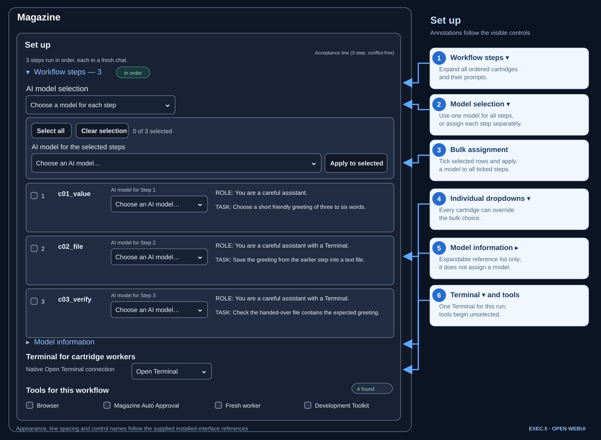
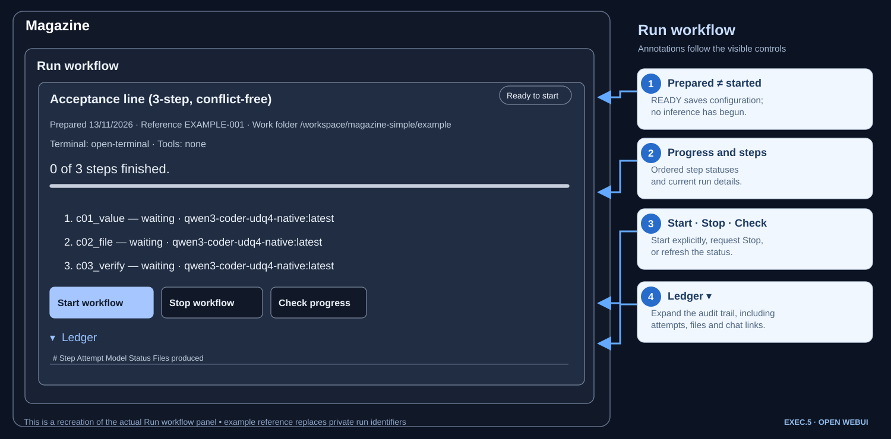
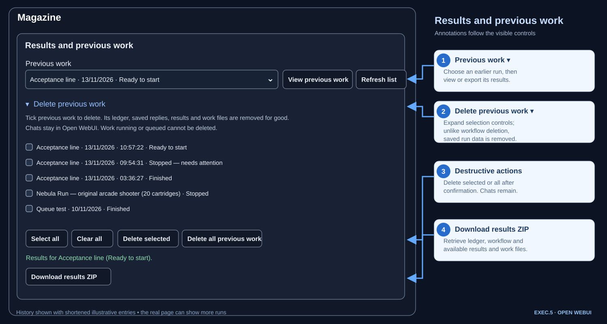
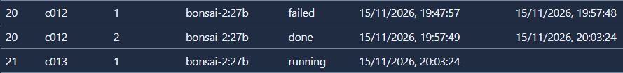

# Magazine

**A simple workflow runner for local AI models.**

Magazine helps smaller language models tackle larger projects by breaking the work into **prewritten, manageable tasks** called *cartridges*. Each cartridge gets a fresh Open WebUI chat with its assigned model. Magazine executes them in order, preserves the work and passes along declared files or values when the next step needs them.

The idea is straightforward: let the model concentrate on **one job at a time**, while Magazine handles the sequence. Magazine does not plan the project or judge whether a model's work is correct. The current runner can make **bounded, targeted recovery attempts** when publication or eligible output-file steps fail; those retries do not guarantee a correct result.

**Current locally installed version:** **Magazine Simple 0.2.0-reliability.2** on **Open WebUI 0.12.5** (16 November 2026). **Sidebar Launcher:** **0.1.0**, unchanged. [**Latest clean source ZIP**](downloads/Magazine-Simple-0.2.0-reliability.2-source.zip) · [**Exact installed Function source**](integrations/open_webui/function/magazine_simple_reliability2.py). The local installation was tested with Bonsai; a separate public clean-install acceptance has not been performed.

## This is what Magazine looks like


*Recreated directly from the supplied 13 November 2026 interface references, using the real layout and control names. The sample workflow and run details are illustrative; this is not a live screenshot.*

**[Explore the complete visual walkthrough](docs/guide/index.html)** — with interactive model-selection examples and explanations of the controls.

### Set up: choose models, Terminal and tools



Expand **Workflow steps** to inspect the cartridges. Choose **one model for all steps** or **a model for each step**, with bulk selection when needed. The **Model information** section is only a reference list. Select a Terminal if the workflow needs one, and tick only the tools required; tools start unticked.

### Run: prepare first, start separately



**Prepare workflow** creates a READY run; it does not start any model. **Start workflow** begins execution, **Check progress** refreshes the status and **Ledger** expands the per-step record. **Stop** is not a pause button. If a run fails or stops, the operator can choose **Continue from this step** when earlier cartridges have completed.

### Results and previous work



You can inspect earlier runs, keep their evidence and export a ZIP. **Delete workflows** removes imported definitions but keeps past runs; **Delete previous work** removes the selected saved run data, while leaving its Open WebUI chats intact. The live delete operation was **not** part of the exec.5 acceptance test.

## How the workflow works


A workflow can contain as many cartridges as its author designs, subject to practical limits. Cartridges can use the same model or different models. In newly prepared runs, file-based results are checked and committed before downstream cartridges begin; original Open WebUI chats remain available for inspection. **Finished** means execution completed and the results were stored, **not** that every answer was correct.

## Latest: automatic loop protection, 30-minute fresh chats and token accounting

Magazine Simple **0.2.0-reliability.2** keeps the validated handover mechanism introduced in handover.1 and adds:

- **Five attempts maximum:** one initial attempt plus up to four recovery attempts. Each fresh work, publication or repair chat receives its own **1,800-second** default allowance, rather than sharing a total cartridge budget. Continue cannot exceed five saved attempts. Older explicit limits remain respected.
- **Built-in Antiloop:** monitors completed, structured tool calls and results while the model is active, warning after three identical repetitions and triggering a confirmed stop after five (or three identical errors). The bounded recovery mechanism receives the evidence. Changing results and silent reasoning are not mistaken for confirmed loops; detection is necessarily incomplete.
- **Antiloop On/Off:** in **Set up → Tools for this workflow**, on by default, saved per signed-in user and workflow and frozen for each started run (including queued work and recovery). An explicit manifest Off remains Off unless the user saves an override. Off does not disable normal timeouts, five-attempt admission, Stop/HALT, handover validation or token accounting.
- **Cumulative token usage:** reported input, output and total consumption are retained for every attempt, cartridge and run in the ledger, run JSON and results ZIP. When a stopped chat supplies no usage, its consumption remains **unavailable/incomplete**, not estimated from its final round.
- **Integrity before next cartridge:** Magazine requires DONE, checks declared files and outgoing selectors, validates the result's run/cartridge/attempt/chat identity, archives the saved chat, commits the verified result with SHA-256 and reads it back. The publisher helper is already embedded in the Function; it is **not** a separate Open WebUI tool.

Historical runs keep their saved modes and are not silently converted or restarted. Verified result structure does not prove semantic correctness.

[Technical and validation record](docs/SIMPLE_0.2.0_RELIABILITY2.md) · [Clean source ZIP](downloads/Magazine-Simple-0.2.0-reliability.2-source.zip) · [Previous handover.1 record](docs/SIMPLE_0.2.0_HANDOVER1.md)

## Real-world recovery: a failed cartridge continued (15 November 2026)

In a live **187-cartridge 3D Resource Kit development workflow** using **Bonsai 2 27B**, cartridge **c012** ended without its required DONE status. Magazine recorded **attempt 1 failed**, created a **fresh second attempt**, retained the earlier project work, and accepted the corrected result. The ledger shows **c012 attempt 2 done at 20:03:24**, followed immediately by **c013 running**.



*Actual ledger evidence, cropped to the relevant rows. Local UI times are shown as recorded.*

The new chat found and corrected invalid Git ignore patterns, checked the result against Git and successfully published its attempt-scoped handover. This is **one observed end-to-end recovery**, not evidence that all 187 cartridges finished or that every failure can be recovered. The recovery model also edited the file despite an instruction to perform verification/publication only; the case study explicitly documents this limitation.

**[Read the recovery chronology, checks and limitations](docs/REAL_WORLD_RECOVERY_2026-11-15.md).**

## Real-world test: 72-cartridge game build (14 November 2026)

Magazine Simple **0.2.0-exec.5** completed a full **72-cartridge** local-model workflow to build *Nebula Run v3 — Stage 1: Cinder Reach*, a browser-based horizontal shooter. The retained Open WebUI **0.12.5** run records **72/72 cartridges done, with one attempt each**, using **Bonsai 2 27B** and Open Terminal. The recorded run lasted **1 hour 59 minutes 39 seconds** (00:23:49–02:23:28 UTC; approximately two hours). The workflow produced a **7.3 MB game ZIP** with verified Magazine file handovers.

The generated game's test suite reported **64 passes, 0 failures**; a software-canvas visual gate passed; and a simulated playthrough reached stage clear. The operator subsequently **confirmed the game ran in Firefox**. The runner itself recorded the browser check as **NOT TESTED**, so this is a user-confirmed desktop execution, not an automated Firefox compatibility or playability certification.

This demonstrates substantial real-world multi-cartridge execution and a runnable game deliverable, **not** perfect game quality or guaranteed success on other projects. The final audit also retained **one expected-file hash mismatch** in an enemy-art script despite passing tests.

**[Read the full evidence, run configuration and limitations](docs/REAL_WORLD_GAME_RUN_2026-11-14.md).** This run used **exec.5**, not the later handover.1 version. It remains valuable historical evidence, not a handover.1 acceptance run.

## Versions, source and release boundaries

| Component | Version | Availability |
| --- | --- | --- |
| **Magazine Simple — current local installation** | **0.2.0-reliability.2** | [**Exact Function source**](integrations/open_webui/function/magazine_simple_reliability2.py) and [**clean source ZIP**](downloads/Magazine-Simple-0.2.0-reliability.2-source.zip). Installed and live-tested on Open WebUI 0.12.5 at `/magazine-simple`. No independent public clean-install acceptance. |
| Earlier Magazine Simple — historical | 0.2.0-handover.1 | [Source](integrations/open_webui/function/magazine_simple_handover1.py), [publisher helper](integrations/open_webui/function/magazine_publish_helper_handover1.py) and [engineering record](docs/SIMPLE_0.2.0_HANDOVER1.md). |
| Earlier Magazine Simple — historical | 0.2.0-exec.5 | [Source](integrations/open_webui/function/magazine_simple_exec5.py) and [notes](docs/SIMPLE_0.2.0_EXEC5.md). |
| Sidebar Launcher | 0.1.0 | [Separate source](integrations/open_webui/function/magazine_simple_sidebar_launcher.py); opens the page but does not execute cartridges. |
| Original Magazine Function | 0.1.0-beta.5 | [Historical Function-only ZIP](downloads/Magazine-0.1.0-beta.5-FunctionOnly.zip), accepted for Open WebUI 0.11.3 at `/magazine`. **Not** a Magazine Simple installer. |

The older patched-Docker sidebar integration remains [historical source](integrations/open_webui/frontend/README.md). The [visual guide](docs/guide/index.html) recreates the **13 November exec.5 interface**, before Antiloop was added, and is not a live screenshot of reliability.2. The clean ZIP contains verified Function code, a page/publisher reference, tests and public notes, but **not** private database backups, logs or chat histories. Install by updating the existing Open WebUI Function; **do not import this ZIP as a cartridge workflow**.

### Testing, correctly attributed

**16 November — reliability.2:** **308 automated passed, 19 skipped, zero failed**. Browser checks ran in Chromium and Firefox. Live **Bonsai 2 27B** tests on Open WebUI 0.12.5 exercised Antiloop On/Off, persisted settings, repeated-tool detection/recovery, normal verified publication and cumulative usage. The five-attempt check used one real stopped chat followed by four controlled startup failures. Two earlier diagnostic trials were rolled back before the accepted installation. **Not tested:** the full 187-cartridge workload, other models, public clean installation or destructive power-loss recovery. [Detailed scope](docs/SIMPLE_0.2.0_RELIABILITY2.md).

**15 November — handover.1:** **193 passed / 90 skipped** in isolated offline testing. The skips include unavailable Chromium and Firefox executables (72 cases), optional screenshots (16) and unavailable legacy fixtures (2). Real Open WebUI/Bonsai testing covered successful malformed-chat-text handover, missing-result recovery, rejection of wrong-chat identity, and fresh-chat repair of a removed required output. **11 actual Bonsai chats** and **eight committed results** were verified from downloaded evidence ZIPs. One additional repair trial completed but was repaired within the original chat; it does not count as proof of runner-level fresh-chat repair. **No other production model was tested on handover.1.**

**13–14 November — exec.5:** A live three-step Qwen3 Coder acceptance workflow completed with Terminal calls and verified file handover; a separate Bonsai 72-cartridge game-building workflow completed. These test the **older** version and are retained rather than reattributed.

**October — beta.5:** **989 automated regressions** across the previous implementation. These are historical, **not** handover.1 test results.

The handover.1 installation report also records that the existing Function was updated in place, other Functions and Workspace Tools remained unchanged, and historical project files were preserved. Crash boundaries were simulated offline; production service restart/power-loss durability was not tested. A committed result verifies integrity and structure, **not semantic correctness**.

[New technical record](docs/SIMPLE_0.2.0_HANDOVER1.md) · [Testing chronology](docs/TESTING.md) · [Changelog](CHANGELOG.md)

<details>
<summary><strong>For coders and engineers — current implementation</strong></summary>

Magazine Simple is an Open WebUI Event Function exposing `/magazine-simple` and authenticated `/api/magazine-simple` routes. Cartridges run sequentially with one fresh saved chat per attempt. Its per-process queue is not a multi-process distributed lock or crash-persistent scheduler.

New runs use `handover_mode: result_file_v1`. An attempt-scoped Python publisher writes the result; Magazine checks DONE, file declarations, output selectors, identity and chat evidence, then commits with SHA-256 and read-back. Existing saved runs retain their original protocol.

```yaml
# Optional magazine.yaml configuration for newly prepared runs
handover_mode: result_file_v1
result_profile: generic
recovery:
  max_attempts: 5
  attempt_seconds: 1800
  io_retries: 2
loop_police:
  enabled: true
  warn_repeats: 3
  stop_repeats: 5
  error_repeats: 3
  cycle_repeats: 3
  history_size: 64
```

Historical `seconds` and `max_retries` aliases are supported with bounded semantics. The saved Antiloop user setting overrides the manifest switch and freezes at Start. DONE remains required in file protocol mode even if the legacy `require_done_line` valve is disabled. Scoped recovery cannot guarantee that a model will obey restrictions on editing files.

**Source identity:** Installed Function SHA-256 `2112da6c358ebfd2b153e26dea1583cbace98714ff11a21bea31af5b44814377`; the [current published source](integrations/open_webui/function/magazine_simple_reliability2.py) matches byte for byte. Clean source ZIP SHA-256 `01f9ef9a8bde75c6b16702a5d440229e6bcab3b1d83dcfa76650ded58abe4404`. Historical handover.1 and exec.5 source remains available.

[Current engineering and test record](docs/SIMPLE_0.2.0_RELIABILITY2.md) · [Previous handover.1 details](docs/SIMPLE_0.2.0_HANDOVER1.md)
</details>

## Licence and safety

Magazine is published under the [MIT licence](LICENSE). Open WebUI and other software retain their own licences. Review workflows and selected tools before running them. For reliability.2, the supplied installation evidence records source identity, automated checks and selected live Bonsai recovery and Antiloop tests. This is not a clean-install, general security or production-readiness certification.

[Historical beta.5 security notes](docs/SECURITY.md) · [Sidebar Launcher details](docs/SIDEBAR_LAUNCHER.md) · [Illustrated guide](docs/guide/index.html)
