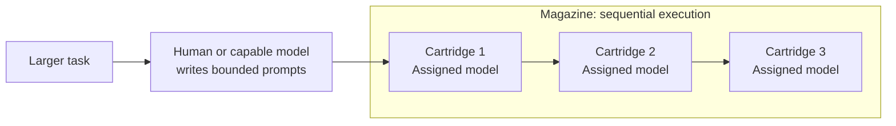
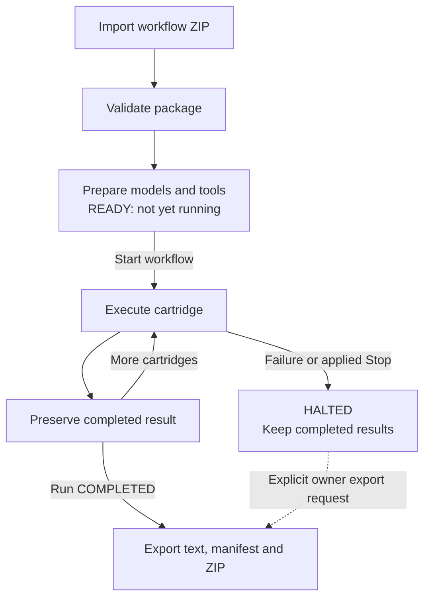
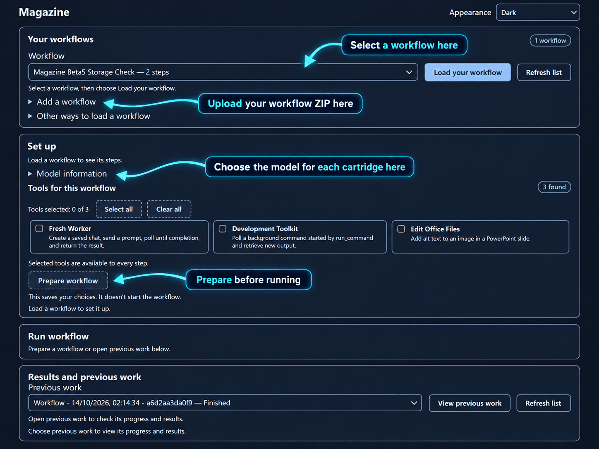
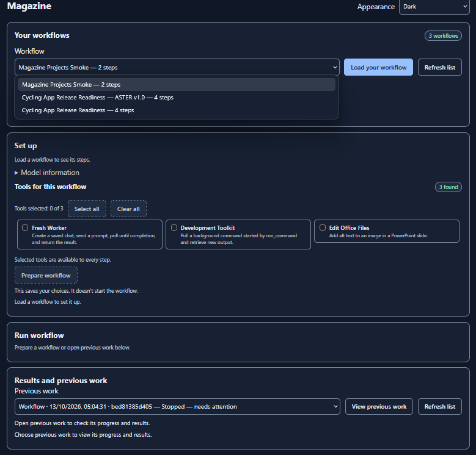

# Magazine

**v0.1.0-beta.5 — Beta / Proof of Concept**

## Choose your Magazine edition

Magazine is available in two versions for different chat interfaces. **Choose the one that matches what you already use.**

| Your interface | Start here |
| --- | --- |
| **Open WebUI** | You're in the right place. The instructions below describe the **0.1.0-beta.5 Open WebUI edition**. [Jump to installation](#install-the-open-webui-function). |
| **Pi Web UI** | [Read the Pi edition guide](pi-web-ui/README.md) · [Pi installation instructions](pi-web-ui/INSTALL.md). The Pi prerelease download is being prepared; it is **not yet available** in this repository. |

Both editions execute independently prepared tasks called *cartridges*, but they have **different installers and compatibility requirements**. Don't install an Open WebUI Function package into Pi or a Pi plugin into Open WebUI.

---

Magazine executes prewritten tasks called *cartridges* through language models
in **Open WebUI**. Each runs in a fresh temporary conversation. Magazine saves the result
before moving on to the next cartridge.

I built Magazine to investigate whether smaller, locally hosted language models
can undertake more complicated work when it's divided into manageable tasks.
A long agentic prompt may ask a model to solve a problem while managing the
overall plan and extensive instructions. That can be a lot to handle at once.

Magazine keeps control of the sequence outside the model. A human or a more
capable model writes the bounded tasks; Magazine executes them using your
assigned models. The worker can concentrate on one task rather than the project.

This doesn't make the model more intelligent. The approach may also suit larger
models, but no comparative benchmark establishes performance improvements for
either. Magazine is an execution system, not an automatic planner: good prompts
and sensible task decomposition still matter.

Magazine is still a beta prototype. The current version demonstrates the core
approach, and additional features are planned as development continues.

## How it works

Each cartridge runs in a fresh Open WebUI conversation without inherited
parent conversation history. Magazine attempts to remove the temporary chat
after preserving its result. The arrows show execution order, **not** output
being passed from one cartridge into the next.

Choose one available model for the workflow or assign models to individual
cartridges. Selected tools are passed through Open WebUI at run level, subject
to its permissions and the model's capabilities. Magazine doesn't provision
tools or grant additional access.

The interface separates preparation from execution. You import and validate a
package, review its prompts, choose models and tools, then prepare a **READY**
run. Nothing starts until you choose **Start workflow**.

Results are saved before the next cartridge starts. **COMPLETED** means the
workflow finished executing and its responses were saved; it does not mean
those responses are factually correct or that the real-world task succeeded.
You'll still need to review the work and run any relevant external checks.

## Interface overview

Magazine's interface brings workflow import, model setup, execution and previous results into one place. The labels below highlight the main controls. Model choices become available after loading a workflow.

*Annotated illustration based on the beta.5 interface. [View the unannotated screenshot](docs/screenshots/magazine-interface-original.png).*

## A practical example

Suppose you want to review a small Python function before using it in a project.
Instead of asking for a broad review in one prompt, you could write these
cartridges, including the same source excerpt in each:

| Cartridge | Bounded task |
| --- | --- |
| Input handling | Identify accepted inputs and cases that could produce unexpected behaviour. Refer to specific lines. |
| Error handling | Inspect the function's failure paths. Explain whether errors are handled or left to the caller. |
| Test preparation | Suggest concrete test cases for the supplied function, including edge cases. Don't claim to have executed them. |

Read these independent inspections together; the third cartridge doesn't
receive the first two answers. Magazine doesn't load your repository into
the prompts for you.

The [two-cartridge example](examples/simple/magazine.yaml) uses a fixed-reply
prompt and an independent arithmetic question to check execution and routing,
not answer correctness. Keep `magazine.yaml` at the root of a workflow ZIP,
alongside its referenced prompts.

## Install the Open WebUI Function

Use the **Function-only integration** with **Open WebUI 0.11.3**. Other versions
haven't been accepted. You'll need administrator access, authentication enabled,
persistent data storage and a working model through your existing Open WebUI
connections, such as Ollama or an OpenAI-compatible provider.

1. Back up your data and any existing Magazine Function. Review the
   [source](integrations/open_webui/function/magazine_ef.py): Functions execute
   Python with server privileges.
2. Download and extract the [beta.5 Function-only package](downloads/Magazine-0.1.0-beta.5-FunctionOnly.zip).
3. Open **Admin Panel → Functions → Create menu → Import JSON**. Import
   `integrations/open_webui/function/magazine-function.json` and enable **Magazine**.
4. Visit `/magazine` on your Open WebUI server, for example
   `http://localhost:3000/magazine`, and bookmark it.

Installation starts no workflows and adds no permanent sidebar button.
Keep your existing Open WebUI image. The [installation guide](docs/FUNCTION_INSTALL.md)
covers updates, backup, rollback and removal.

*Magazine interface during local beta.4 testing. The Function-only installation opens at `/magazine` without adding a sidebar button.*

## Everyday use

Check that your account can use the model in an ordinary Open WebUI chat.
An administrator imports a ZIP into the shared library. Choose **Load your
workflow**, review its cartridges and select models and tools.

Choose **Prepare workflow**, inspect the READY run, then choose **Start workflow**.
**Check progress** shows status and responses; **View previous work** opens
earlier runs without restarting them.

**Stop workflow** preserves completed results and prevents later cartridges
from starting once Stop takes effect. If active inference cancellation can't
be confirmed, the current cartridge may finish before the workflow stops at
the next safe boundary. If the final cartridge finishes first, the run may
remain COMPLETED. An eligible failure-halted run can be prepared to
continue through explicit recovery, which does not itself start execution.
A run with a durable Stop request cannot use that recovery path; Stop is not
Pause/Resume. See [STOP and recovery behaviour](docs/STOP.md).

## Input ZIPs and Finished Work

Beta.5 separates original packages from finished outputs:

- **Input-ZIPs** retains an exact copy of a successfully imported workflow ZIP.
  Placing other ZIPs in that folder doesn't import them.
- **Finished-Work** contains saved cartridge text, a machine-readable manifest
  and `results.zip`, organised by owner, project and run. COMPLETED runs export
  automatically; HALTED runs' completed portions require an explicit owner request.

Defaults are `DATA_DIR/magazine/input-zips/` and `DATA_DIR/magazine/finished-work/`.
Optional Docker bind mounts expose host folders, such as
`C:\AI_Workflows\Magazine\Input-ZIPs` and `C:\AI_Workflows\Magazine\Finished-Work`.
The server-side settings are `MAGAZINE_INPUT_ZIPS_DIR` and
`MAGAZINE_FINISHED_WORK_DIR`.

Read responses in Magazine or open the ZIP in Finished Work. Internal history
and recovery records stay in `DATA_DIR/magazine/runs/`. Export retries don't
overwrite unrelated work; storage failures are reported without discarding
canonical results. [Storage setup](docs/STORAGE.md) covers Windows/Linux mounts,
retrieval, permissions and backups. Retain the existing data volume and
deployment settings when adding mounts.

## Testing and evidence

The beta.5 acceptance evidence records **989 passing regression tests**:
611 core, 244 Function and 134 interface/sidebar cases. They cover execution
and state, sequential routing, STOP/recovery, user ownership, persistence,
ZIP validation/retention and Finished Work exports.

Separate beta.5 checks verified packaged installation, authentication and
restart persistence on isolated stock Open WebUI 0.11.3. Windows Docker
bind-mount tests ran two sequential cartridges through the real core with
deterministic injected responses, not live inference. Release archives were
checked for reproducibility and source parity.

Real Bonsai inference/STOP and browser testing belong to the retained beta.4
baseline; they weren't rerun as beta.5 live tests. The [testing summary](docs/TESTING.md) and [acceptance report](docs/ACCEPTANCE.md) distinguish these results and their limits. [Validation](docs/VALIDATION.md) explains how to run the source checks.

## Current limitations

- Prompts must be self-contained. Earlier results aren't automatically injected
  into later cartridges; there is no automatic planning, repair or model substitution.
- The tested deployment is a single Linux backend, including Docker Desktop
  on Windows. Multi-worker/Redis deployments and proxy path prefixes aren't accepted.
- Finished Work exports only the canonical cartridge text Magazine possesses,
  not separate Development Toolkit files or reconstructed chat archives.
- A backend interruption can leave export work incomplete. The documented
  retry/manual-inspection process is separate from execution recovery; no
  automatic resume or historical ZIP backfill is performed.

For a more detailed explanation, see [current limitations](docs/LIMITATIONS.md).

## Security, licence and repository guide

Use trusted packages and review tool permissions. Magazine doesn't patch or
certify your Open WebUI host's security. Read the
[security notes](docs/SECURITY.md) before using it with untrusted inputs.

Magazine uses the [MIT licence](LICENSE); Open WebUI and its dependencies retain
their own licences. See [licensing](docs/LICENSING.md). The customised sidebar
image remains on **security and licensing distribution HOLD**, separate from
the public Function-only route. Its [source recipe](docs/INSTALL.md) is for
review, not an approved binary release.

`magazine/` contains the independent execution core;
`integrations/open_webui/function/` contains the native Function and interface.
`examples/simple/` holds the small workflow; `tests/` and integration tests hold
the regression suites. [Changelog](CHANGELOG.md) and [release notes](docs/RELEASE_NOTES.md) summarise beta.5.
