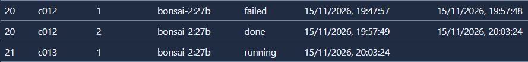

# Live cartridge recovery — 15 November 2026

**Evidence type:** observed execution of a local development workflow, not a synthetic failure test.

**Environment:** Magazine Simple **0.2.0-handover.1**, Open WebUI **0.12.5**, model **`bonsai-2:27b`**, workflow **3D Resource Kit for Open WebUI**. The operator identifies this as a **187-cartridge run**. This record covers one interrupted cartridge only, **not the entire workflow's final result**.

## Recorded outcome

*Actual screenshot supplied by the operator. Cropped to three relevant ledger rows without changing their labels or timestamps. The screenshot does not display its time-zone setting.*

| Cartridge | Attempt | Model | Status | Start (local UI) | End (local UI) |
| --- | ---: | --- | --- | --- | --- |
| c012 | 1 | `bonsai-2:27b` | **failed** | 19:47:57 | 19:57:48 |
| c012 | 2 | `bonsai-2:27b` | **done** | 19:57:49 | 20:03:24 |
| c013 | 1 | `bonsai-2:27b` | **running** | 20:03:24 | — |

This ledger verifies the missing element that a chat transcript alone cannot prove: **Magazine accepted the recovered cartridge and started the next one**.

## Sequence observed in saved Open WebUI chats

1. **Initial work (c012 attempt 1).** The model created a project `.gitignore` for virtual environments, secrets, database files, downloaded binaries and generated outputs. Several patterns, such as `^downloads/` and `^dist/`, were incorrect: Git treats `^` as a literal character, **not** as a root anchor.
2. **Interrupted response.** Magazine recorded `DONE_MISSING`: the final saved model reply did not end with the required `{"status":"DONE"}`. Its recovery block reported the last model round as **64,672 prompt tokens + 864 generated tokens = 65,536 tokens**, with **no stop reason recorded by Open WebUI**. This is consistent with reaching a 64-Ki-token context boundary, but does **not** conclusively establish the cause.
3. **New recovery chat (c012 attempt 2).** The saved prompt identifies a distinct attempt and the original attempt as `parent_attempt_id`. It supplies the specific `DONE_MISSING` diagnostic and instructs the model to inspect retained candidate files, not assume that the task must be recreated.
4. **Verification and correction.** The model found the previous `.gitignore`, corrected root-level patterns to `/dist/`, `/build/`, `/cache/`, `/downloads/` and `/backups/`, and used a temporary Git repository for `git check-ignore` tests. Its final record reports **14/14 positive ignore checks**, plus checks that `resource_kit/downloads/`, source files, tests and design documents remained eligible to be tracked.
5. **Published handover and continuation.** The saved tool result reports a successful call to Magazine's attempt-scoped `publish_result.py`, writing `publish/result.json` with SHA-256 `eb0429834ea1b5aeb5fcfb73c3d0df32d3f23ea248f596d72b6fab882d6be1e8`. The chat then ended with `{"status":"DONE"}`. The ledger independently records c012 attempt 2 as done and c013 as running.

## What this demonstrates — and what it does not

**Supported:** failure detection for a missing DONE line; fresh-chat retry of the same cartridge; retention and reuse of work already on disk; successful file-result publication; accepted c012 completion and sequential advancement to c013. The earlier failed attempt remains visible in the execution history.

**Important behavioural exception:** The recovery instructions explicitly restricted attempt 2 to **verification and publication only**, and said to HALT if an edit was necessary. The model nevertheless **edited `.gitignore`**. That fix was substantively correct and checked, but the model did **not** follow the stated recovery boundary. This example must therefore **not** be presented as evidence that publication-only recovery reliably prevents edits. An enforced tool-level or filesystem-level guard would be needed to guarantee that property.

**Not established:** the precise reason the first model response stopped, successful model compaction, a general recovery success rate, resilience to a process crash or power loss, or completion of all 187 cartridges. The Git checks are reported in the saved chat/tool output; they are not an independent full-project audit.

## Evidence and publication scope

The operator supplied the two c012 attempt exports, a later completed export of attempt 2, and the execution-history screenshot. The publication result and end status were checked against the **completed** attempt-2 export, rather than inferred from its earlier partial export. This page publishes only a cropped screenshot and sanitised chronology: **raw chats and internal attempt paths/identifiers have not been uploaded**.

This case is separate from the [controlled handover.1 acceptance tests](SIMPLE_0.2.0_HANDOVER1.md) and the [72-cartridge browser-game run](REAL_WORLD_GAME_RUN_2026-11-14.md), which used the earlier exec.5 version. Do not combine their counts into a reliability statistic.
