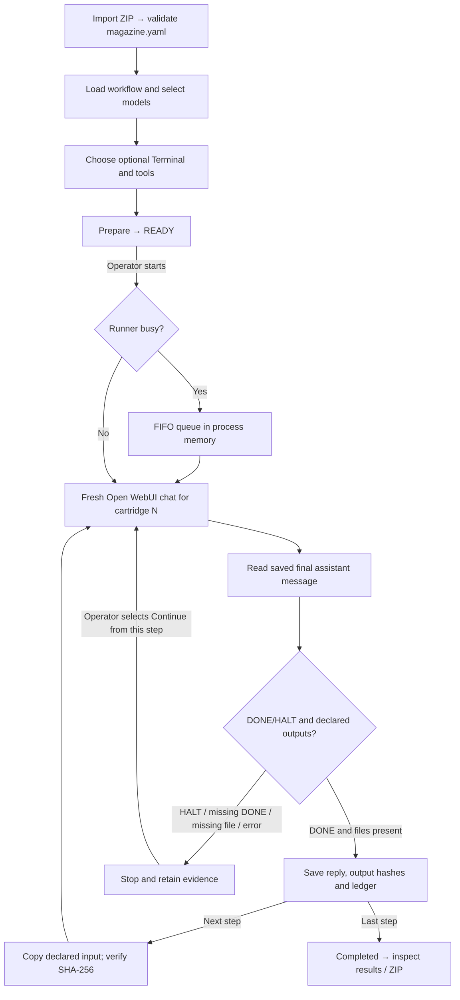

# Magazine Simple 0.2.0-exec.5 — engineering reference

**Version:** `0.2.0-exec.5` · **Open WebUI host:** `0.12.5` (declared and locally tested) · **Recorded installation date:** 13 November 2026.

**Canonical source:** [`magazine_simple_exec5.py`](../integrations/open_webui/function/magazine_simple_exec5.py), **111,367 UTF-8 bytes**, SHA-256:

```text
400f8bf4739bac012ce5c0036eb0ecbcf098695e2a9726a00eef84df934d1309
```

The uploaded source was byte-matched to the local installation record before publication. Its embedded `PAGE_HTML` also hashes to SHA-256 `b1b41a55bb2e5ad3f32582bfc9986357fc16a31850d0b448b709a5a252cc2f97`, matching the reported served-page hash. The Git blob represents those **exact bytes** (blob SHA-1 `5c0a31353fa7bb1bc4cb7ff2efc54862ae58f6d2`). This establishes **source identity**, not independent clean-install or security certification.

[Main README](../README.md) · [Actual-interface visual guide](guide/index.html) · [Launcher notes](SIDEBAR_LAUNCHER.md) · [Historical testing](TESTING.md)

## Source code map

| Location | Purpose | Version scope |
| --- | --- | --- |
| [`integrations/open_webui/function/magazine_simple_exec5.py`](../integrations/open_webui/function/magazine_simple_exec5.py) | Self-contained Magazine Simple Event Function: current runner, page, API routes and engine | **0.2.0-exec.5** — the locally accepted, source-matched implementation |
| [`integrations/open_webui/function/magazine_simple_sidebar_launcher.py`](../integrations/open_webui/function/magazine_simple_sidebar_launcher.py) | Independent navigation-only Sidebar Launcher | **0.1.0** (for Open WebUI 0.12.5) |
| [`integrations/open_webui/function/magazine_ef.py`](../integrations/open_webui/function/magazine_ef.py) and [`magazine/`](../magazine/) | Previous, larger Function and execution core; retained to support historical source and releases | **Legacy beta.5**, not the Simple runner |
| [`tests/`](../tests/) and [`integrations/open_webui/function/tests/`](../integrations/open_webui/function/tests/) | Historical core, Function and interface regressions | **Legacy beta.5 tests**; not an exec.5 acceptance suite |
| [`release/`](../release/) and [`scripts/`](../scripts/) | Historical release manifests, packaging and verification scripts | Currently target **beta.5**; do not treat their passing checks as exec.5 validation |
| [`docs/guide/`](guide/) and [`docs/images/`](images/) | Illustrated interface documentation (not functional runner code) | **Simple exec.5 visual guide** |

For the historical beta.5 installer and storage model, follow the explicitly marked legacy documents. The Simple installation record and technical details are on **this page**.

## Purpose and design boundaries

Magazine Simple is a **pre-authored, sequential LLM workflow executor**, not a planner or review agent. Each cartridge is a saved, ordinary Open WebUI chat with a selected model and the run's optional Terminal and tool IDs. A cartridge receives its own prompt, any explicitly declared file inputs and any requested JSON values from prior replies. Chats are **kept** in Open WebUI.

The engine does **not** automatically:
- create or rearrange cartridges;
- choose models;
- review or fix model outputs;
- retry a failed cartridge;
- compress model context; or
- impose an inference time limit.

A human/operator can use **Continue from this step** to rerun from a selected cartridge. This is a new attempt with a **fresh chat**, not continuation of the previous conversation. All previous attempts remain in saved evidence.

## Implementation overview

| Element | Source implementation |
| --- | --- |
| Open WebUI Function | `Event` with `Valves` and `install_routes()` |
| HTTP/API client | `OpenWebUI` class uses authenticated `httpx.AsyncClient` requests to Open WebUI's native chat APIs |
| Saved-chat execution | `run_chat()`: creates `/api/v1/chats/new`, starts `/api/chat/completions`, polls `/api/tasks/chat/{id}`, reads the saved assistant reply |
| Sequential scheduling | `Engine` processes cartridges in order, one active run per Open WebUI process, with an in-memory first-come queue |
| Persistent run state | `Store` writes `run.json` and `LEDGER.md` into owner-scoped run directories |
| File handover | `prepare_files()` copies declared input bytes while hashing them and checks earlier recorded output bytes/SHA-256 |
| Output completion | `collect_outputs()`, `closing_object()`, `judge()` verify files and the final response's closing status |
| Export | `build_download()` packages the ledger, `run.json`, workflow copy, results and work files |

### High-level sequence



**The diagram is a logical flow, not an assertion that queued runs or manual restarts survive process restart automatically.** The queue itself is not durable.

## Workflow package format

A ZIP needs `magazine.yaml` or `magazine.yml` at its root, or under one enclosing top-level folder, with nonempty cartridges. Example:

```yaml
schema_version: "1.0"
name: "Example handover"
cartridges:
  - id: c01_create
    model: writer
    prompt_file: cartridges/01-create.md
    artifacts:
      outputs:
        - data/output.txt

  - id: c02_check
    model: reviewer
    prompt_file: cartridges/02-check.md
    artifacts:
      inputs:
        - from: c01_create
          path: data/output.txt
```

`model` (or legacy `job_type`) is a *logical key* used in the YAML; the user maps the key or step ID to a specific Open WebUI model before preparing. Model selection supports a shared model and per-step/bulk assignment. There is no fixed cartridge count in the execution architecture, although ZIP-member and resource limits apply.

Declared `handover` entries can also select values from a prior JSON response with JSON Pointer syntax, for example:

```yaml
handover:
  - from: c01_create
    select: /greeting
    as: expected_greeting
```

Only earlier cartridges can be referenced. Declared input files must match an earlier declared output. Older unused fields such as `artifacts.review` and `constraints` are ignored by this Simple runner; do not represent them as active review features.

### Input and output handling

- ZIP import checks relative paths, invalid references and link entries, and stages imports before publishing them to the shared library. It rejects a colliding **workflow-library name**, but the code does not explicitly reject duplicate archive-member names; do not rely on it to detect that condition.
- The importer limits an incoming ZIP to **16 MiB**, **2,000 file members** and **64 MiB total declared uncompressed content**.
- Per-cartridge output files are collected by declared path, type checked and hashed. Missing required files fail the step.
- Input handover compares source size and SHA-256 with the completed earlier step's recorded output. If changed, the handover is rejected.
- The work folder is a shared path visible to both Magazine and the selected Terminal. The default is `/workspace/magazine-simple`. A correct Docker bind or shared volume is an environment requirement, not something the Function provisions.
- The ZIP download imposes an approximately **256 MiB** collected-file limit. When exceeded, it inserts `TRUNCATED.txt`; therefore an export may omit remaining files.

## Completion, failure and restart

**Default valve `require_done_line=True`.** A cartridge is marked done only after its saved final assistant message concludes with `{"status":"DONE"}` and required declared output files are present. The parser also accepts a final inline `DONE` object following a completed sentence; this branch was exercised in the reported live exec.5 acceptance.

The engine recognises a top-level `{"status":"HALT","reason":"..."}` and stops the workflow. Missing DONE, missing files, saved-chat failures and unexpected errors also stop execution, retaining the attempts and files for inspection.

The source implements **Continue from this step** via `POST /api/magazine-simple/runs/{run_id}/restart`. Restart is permitted only when **all earlier cartridges** have status `done`. Existing attempt outputs/prompts are moved aside using attempt suffixes rather than overwritten silently. There is no automatic repair or repeat.

### Queue and process restart

- The `Engine` runs **one active workflow at a time per Python process**; others wait FIFO.
- The queue and its authentication tokens live **in memory**, so a process restart discards queued entries; stale queued runs are moved back to their previous state when inspected.
- An active interrupted workflow is marked `interrupted` when detected on a subsequent run-list request. A human must choose how to restart.
- This is **not** a guaranteed global multi-worker lock. No claim is made for multiple backend replicas or Redis-based scheduling.

## Storage and ownership

Default data root: `DATA_DIR/magazine-simple`.

| Stored material | Default organisation |
| --- | --- |
| Shared workflow library | `DATA_DIR/magazine-simple/library/{workflow_id}/` |
| Run state and captured workflow copy | `DATA_DIR/magazine-simple/runs/{owner_id}/{run_id}/` |
| Canonical ledger | `runs/{owner_id}/{run_id}/LEDGER.md` (also copied to workspace when possible) |
| Saved reply and prompt files | `runs/{owner_id}/{run_id}/results/` |
| Terminal work and declared outputs | `/workspace/magazine-simple/{run_id}/{cartridge_id}/` |

**Important permission distinction:** The workflow library is shared, and the source allows **any authenticated user to add or remove workflow definitions**. Runs, run histories and downloads are owner-scoped through `get_current_user`. Deleting a library workflow does not delete its existing runs; deleting previous work removes that owner's saved run records and work files but **does not delete Open WebUI chats**. The previous-work delete UI was verified in Chromium without actually executing live deletion.

## HTTP endpoints

The Function serves the page at `GET /magazine-simple` and uses the `/api/magazine-simple` prefix.

| Method and route | Purpose |
| --- | --- |
| `GET /workflows`, `GET /workflows/{id}` | List and inspect shared definitions |
| `POST /workflows/import` | Import a base64-encoded ZIP |
| `POST /workflows/delete`, `DELETE /workflows/{id}` | Delete shared definitions |
| `GET /options` | List models, tools and Terminal connections |
| `GET /runs`, `GET /queue` | Owner's runs and sanitised queue status |
| `POST /runs` | Prepare a run (optionally start via explicit `start` field) |
| `POST /runs/delete` | Delete owner's non-running, non-queued previous work |
| `POST /runs/{id}/start`, `GET /runs/{id}` | Start and inspect |
| `POST /runs/{id}/stop` | Request Stop or remove from waiting queue |
| `POST /runs/{id}/restart` | Continue from selected cartridge |
| `GET /runs/{id}/download` | ZIP export |

API handlers use `Depends(get_current_user)`; the page itself is a static HTML route. Function registration removes/reinserts the Simple routes on appropriate Function lifecycle events. **Do not conflate this with the legacy `/api/magazine` endpoints.**

### Valves

| Valve | Default | Meaning |
| --- | --- | --- |
| `library_root` | Empty | Resolve to `DATA_DIR/magazine-simple/library` |
| `workspace_root` | `/workspace/magazine-simple` | Shared working files |
| `open_webui_base_url` | Empty | Infer `http://127.0.0.1:{PORT or 8080}` |
| `require_done_line` | `True` | Require final DONE/HALT status; disabling falls back to the earlier completion rule based on required files |

The source declares `httpx==0.28.1` and `PyYAML==6.0.3` as requirements. It relies on Open WebUI's FastAPI/Pydantic environment.

## Deployment and launcher

The **Sidebar Launcher 0.1.0** is [separate source](../integrations/open_webui/function/magazine_simple_sidebar_launcher.py). It adds a browser link to `/magazine-simple` by modifying Open WebUI's `STATIC_DIR/loader.js` and retains backups; it does not schedule a run or change the engine. Keep the historical patched-Docker integration separate.

**Source publication is not an independently accepted installer.** The reported installation was an in-place update of an existing Function via Open WebUI's API. A clean install from the published source, host-security review, upgrades on other Open WebUI versions and lifecycle rollback are outside the supplied exec.5 acceptance.

## Test evidence and boundaries

The maintainer's 13 November 2026 installation report identifies:
- In-place update at **09:33:51 UTC**, same Function ID, enabled/not global, valves shown as `{}` in the saved record; no other Functions modified.
- Page SHA-256 prefix/suffix `b1b41a55…2f97` and exact installed Function source hash above.
- **178 existing run files** hash-identical before and after the update.
- Live run `20261113-093654-9352d6` completed with **three cartridges** on `qwen3-coder-udq4-native:latest`, Open Terminal and no additional tools.
- Steps 2 and 3 executed real `run_command` calls; the declared file handover was checked (hash prefix `fc70a5e3…`) and `result.json` reported `match: true`.
- Step 2's final answer exercised the inline DONE branch.
- Exported ZIP SHA-256 prefix/suffix `0670ae9e…a21d`.

**Not tested:** live deletion, Firefox UI interactions beyond loading the page, or Open WebUI container logs. The Chromium deletion UI was inspected, and cancellation sent no deletion request; the confirmation box was replaced for that test.

**Historical test lineage:** The older public beta.5 implementation passed **989 automated regressions** (611 core, 244 Function, 134 interface/sidebar). Beta.4 live Bonsai checks were earlier again. These remain valuable historical evidence but **do not establish 989 passing tests on exec.5**.

See [the testing chronology](TESTING.md). The source-preserving updated docs have been reviewed for version drift. Python syntax compilation completed locally, and **9 focused source-level smoke checks passed** (DONE/HALT parsing, completion conditions, relative-path rejection and handover YAML parsing). Those checks were **not** live Open WebUI integration or a full regression suite.
