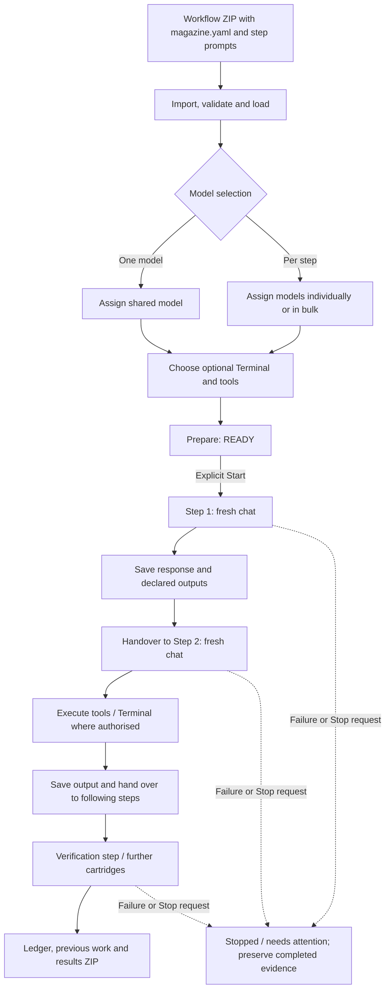

# Magazine Simple 0.2.0-exec.5 — installed-version record

**Date:** 13 November 2026  
**Scope:** locally installed Open WebUI edition and acceptance evidence supplied by the maintainer.  
**Public download status:** **not packaged or published as an exec.5 runner release here**. The source code and downloadable Function already in this repository are from the older **0.1.0-beta.5** edition.

[Plain-English README](../README.md) · [Illustrated interface](guide/index.html) · [Sidebar Launcher 0.1.0](SIDEBAR_LAUNCHER.md)

## What this edition does

Magazine Simple is the current, streamlined Open WebUI implementation. A user imports a workflow ZIP, loads its ordered cartridges, chooses one model for the whole run or selects models step by step, optionally selects a Native Open Terminal connection and Open WebUI tools, then **prepares** a run. Preparation saves the selections but does not start work. The user presses **Start workflow** separately.

Each cartridge runs in a **fresh conversation**. Its response and declared output files can be preserved and made available to dependent cartridges. A ledger and previous-run records support inspection and export. These steps are prewritten; Magazine is not an automatic task planner, model improver or task-success judge.

### Execution sequence

Arrows represent execution order and *declared* handovers; they do not imply that every workflow must use Terminal, have three cartridges, or automatically verify its own correctness.

### Present interface

The new page is served from **`/magazine-simple`**, not the older beta.5 `/magazine` address.

| Section | Controls and behaviour |
| --- | --- |
| **Your workflows** | Select/load a workflow; refresh; expand **Delete workflows** to delete imported definitions (existing run history retained); expand **Add a workflow** to import a ZIP and optional short name |
| **Set up → Workflow steps** | Expand/collapse cartridges; choose the same model for all steps, or choose per-step models with checkbox bulk assignment and individual overrides |
| **Model information** | Expand/collapse a reference list of available models; the list does not assign them |
| **Terminal for cartridge workers** | Select an available Native Open Terminal connection or none; one choice for the run |
| **Tools for this workflow** | Tick the tool permissions requested for the run; no tools are selected by default; host permissions still apply |
| **Prepare workflow** | Create a READY run without beginning execution |
| **Run workflow** | Display run ID, work folder, models, progress, Start/Stop/Check progress and expandable **Ledger** |
| **Results and previous work** | Select a historical run, view results or export a ZIP; expandable **Delete previous work** has its own selection and confirmation actions |

**Deletion distinction:** Removing a workflow definition keeps earlier work; removing previous work is intended to erase that run's ledger, saved replies, results and files. Open WebUI chats remain. Running or queued work cannot be deleted. The deletion interface was tested, **not** its live delete operation.

[Open the complete annotated HTML walkthrough](guide/index.html). It is documentation, not a separately installed app.

## Installation evidence supplied by the maintainer

The following records refer to the existing **local exec.5 installation**, not a new test of the files in this public repository.

| Item | Evidence |
| --- | --- |
| Update | 13 Nov 2026, 09:33:51 UTC, in place via `POST /api/v1/functions/id/magazine_simple/update` |
| Function identity | Existing ID retained, enabled, not global; valves `{}`; unrelated Functions untouched |
| Installed code | 111,367 bytes; SHA-256 abbreviated **`400f8bf4…1309`** |
| Served page | `/magazine-simple`, `page.html` abbreviated SHA-256 **`b1b41a55…2f97`** |
| Before/after preservation | Existing run folders: **178 files**, all hashes identical |
| Local backup | `C:\Codex\Magazine\Magazine-Simple-installed-backup-0.2.0-exec.3-pre-exec.5-20261113\\`, including stored code, Function record and `ROLLBACK.txt` |
| Live acceptance | Run `20261113-093654-9352d6`; three steps completed |
| Model / connected resources | `qwen3-coder-udq4-native:latest`; Open Terminal; no additional tools |
| Real tool calls | Steps 2 and 3 executed Terminal `run_command` |
| Handover check | File hash prefix **`fc70a5e3…`**; `result.json` reports `match: true` |
| Completion branch | Inline `DONE` following sentence in step 2 exercised live |
| Export | `Magazine-20261113-093654-9352d6.zip`; SHA-256 abbreviated **`0670ae9e…a21d`** |

The abbreviated hashes are **not complete independent file verification references**. Full values and source must be obtained from the saved local acceptance artefacts; do not reconstruct them from the displayed prefixes/suffixes.

### Verified and not verified

**Verified in the supplied installation record:** installed source parity with candidate, unchanged existing run files, real three-cartridge execution with Terminal, declared file handover, matching verification result, inline DONE handling, prepared/run views, and the Chromium previous-work deletion UI placement/selection state.

**Not verified:** actual deletion of saved work (explicitly not performed), Firefox UI interactions (the page loaded but direct interaction was unavailable), or Open WebUI container logs.

The existence of an export and a completed status does not itself prove the model's answer is correct outside the acceptance-line checks.

## Sidebar Launcher 0.1.0

The separately installed **Magazine Simple Sidebar Launcher 0.1.0** specifies **Open WebUI 0.12.5** and adds a Magazine link to `/magazine-simple` in the sidebar, opening it in a new tab. It is a navigation integration, **not** a second runner. The supplied source is now kept at:

[`integrations/open_webui/function/magazine_simple_sidebar_launcher.py`](../integrations/open_webui/function/magazine_simple_sidebar_launcher.py)

See [launcher technical notes](SIDEBAR_LAUNCHER.md) for loader behaviour, backups and risk boundaries. The older Docker-patched sidebar recipe remains for historical beta.5 users; **do not combine it with the launcher as if both were required**.

## Evidence lineage: don't mix builds

The older published **Magazine beta.5** has **989 recorded passing regressions**: 611 core, 244 Function and 134 UI/sidebar. The beta.5 acceptance record includes an isolated stock Open WebUI 0.11.3 check, deterministic injected-response tests and source/archive parity. Its predecessor beta.4 has the separately retained live Bonsai tests. These results remain valid **for those versions**, not as freshly rerun Simple exec.5 tests.

The exec.5 installation evidence above is useful, particularly because it specifically covers the prior persistent completion/handover fault area with an inline DONE branch, real tool calls and verified handover. It is still **one live three-step scenario**, not proof that the older 989 tests pass on the simplified codebase.

[Historical testing](TESTING.md) · [Historical beta.5 acceptance](ACCEPTANCE.md) · [Public beta.5 installation](FUNCTION_INSTALL.md)

## Publication and installation limits

- This update publishes **documentation and the supplied Sidebar Launcher source only**, not the newer runner's 111,367-byte Function source or a corresponding `0.2.0-exec.5` install package.
- Do not use the old beta.5 installer to claim an exec.5 installation. The beta.5 Function route is `/magazine` on its accepted Open WebUI 0.11.3 baseline.
- Do not replace an existing local exec.5 Function with the public beta.5 package without an explicit downgrade/rollback decision.
- Existing data, authentication, tool permissions and persistent volumes belong to the user's Open WebUI instance; the documentation-only HTML does not access them.
