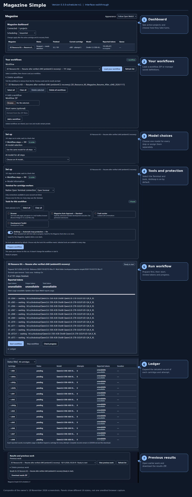

# Using Magazine — quick guide

[Back to Magazine](../README.md) · [Technical guide](TECHNICAL_0.3.0_SCHEDULER_RC1.md)

*This continuous illustration joins cropped, genuine screenshots of different interface states. The arrows describe the controls; it is not one unedited browser capture.*

## 1. See your projects

The **Magazine dashboard** shows what is running, waiting, stopped or completed. It also shows progress, the model being used and reported tokens. Use **Scheduling** to choose whether projects finish one at a time (**Sequential**) or take turns after each completed cartridge (**Round Robin**). One cartridge runs at any moment.

## 2. Add and load a workflow

Open **Add a workflow**, select a **workflow ZIP** and add it. Then choose it in **Your workflows** and press **Load your workflow**. A workflow ZIP contains the tasks. It is not the Magazine software.

The **Delete workflows** control removes imported workflow definitions. Existing saved runs and their results are kept.

## 3. Choose models and tools

In **Set up**, choose one AI model for every step or assign different models to selected steps. Pick the **Terminal** connection for the run. Tick only the tools you need; tools are not selected by default.

The **Antiloop** switch can detect certain repeated tool actions that are not making progress. It cannot recognise every loop and does not judge whether a result is correct.

## 4. Prepare and start

**Prepare workflow** saves your selections and creates a run that is **ready to start**; no model is launched. Press **Start workflow** when ready. You can also **Check progress** or **Stop workflow**.

Stop is not a pause button. When a project fails or is stopped, examine its ledger and use **Continue from this step** only when the run offers that action.

## 5. Read the ledger and keep your results

The **Ledger** now shows **one selected cartridge at a time**. Use the selector, Previous/Next and status filter, or enable Follow current to track the running cartridge. The four-field summary keeps model and duration beneath it; expand cartridge details and individual attempts for tool evidence, retry decisions and full records. Unavailable token counts are labelled honestly rather than guessed. The run header also distinguishes cumulative timed-attempt duration from the overall execution span. Attempt-specific View chat links open recorded native Open WebUI chats in a new tab; signing in through your normal browser session is required.

Under **Results and previous work**, open saved runs and download a **results ZIP**. Reopening Magazine should restore saved details; stopped or interrupted work does not run again automatically.

## Things to keep in mind

Your local models, Open WebUI and selected tools do the work. Magazine organises their tasks and evidence. Always check generated code and tests before treating a completed run as correct. Use a separate workspace or explicit coordination if multiple projects could edit the same files.
