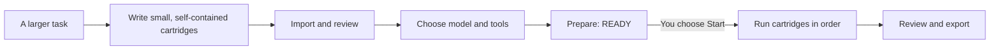
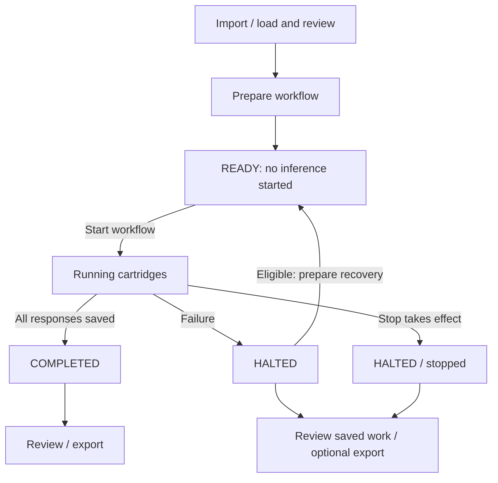

# Magazine for Pi Web UI

**Beta release candidate: 0.1.0-pi.3-rc.1**

[Installation guide](INSTALL.md) · [Open WebUI edition](../README.md) · [Report a problem](https://github.com/Nundrian/Magazine/issues)

Magazine helps a smaller language model work through a larger project **one manageable task at a time**. It also works with larger models.

You prepare the tasks, called **cartridges**, in advance. Magazine runs them in order in fresh Pi sessions, keeps the responses, and lets you review or export the results.

**This is an execution tool, not an automatic planner.** It doesn't write the project plan for you, improve a model's intelligence, or automatically feed one cartridge's answer into the next.

> **Release status:** The Pi edition has completed its documented candidate tests. Its download archives have not yet been published in this repository. These instructions are provided ahead of the first public prerelease; check [GitHub Releases](https://github.com/Nundrian/Magazine/releases) for the eventual Pi package before attempting installation.

## At a glance

- **Useful for small local models.** Break a job into focused prompts instead of expecting one model to manage the whole project at once.
- **Choose your model.** Use one available Pi model throughout or assign models to individual cartridges.
- **Review before starting.** Preparing a workflow creates a **READY** run; nothing executes until you choose **Start workflow**.
- **Keep your work.** Magazine saves responses and run history and supports downloads.
- **Stay in control.** Stop prevents later cartridges starting; eligible failures have a separate, explicit recovery route.
- **Works inside Pi.** Magazine is an optional Pi Web UI plugin, not a replacement for Pi or Open WebUI.

## How it works

**In plain language:** Write the tasks → load the workflow → choose a model → prepare → start → read the results.

Each cartridge runs with its own fresh Pi session rather than inheriting the previous cartridge's conversation. The arrows describe **execution order**, not automatic transfer of answers between cartridges.

### The three parts of the interface

| Step | What you do |
| --- | --- |
| **1. Load your workflow** | Choose a workflow from the library, import a trusted project ZIP as an administrator, or use a Magazine JSON document. |
| **2. Choose models and tools** | Pick your model and review whether any tools are necessary. You can assign different models to different cartridges. |
| **3. Execute and review** | Prepare, then explicitly start. Check progress, stop if necessary, view earlier runs, and export saved results. |

## A simple example

Imagine asking a local model to review a Python function. Rather than giving it one large instruction, prepare three **independent** cartridges:

| Cartridge | The task |
| --- | --- |
| 1. Inputs | List possible input errors and edge cases using the supplied function. |
| 2. Error handling | Examine exceptions and failure paths in that same supplied function. |
| 3. Test ideas | Propose concrete tests for that function; don't claim to have run them. |

Each cartridge must contain the source it needs. You then review the three saved answers together. Magazine doesn't automatically insert earlier answers into later prompts.

## Install Magazine for Pi

Read the **[step-by-step installation guide](INSTALL.md)** before installing. It covers prerequisites, Docker, authentication, your first workflow, upgrading and rollback.

**Validated environment**

| Component | Supported/tested target |
| --- | --- |
| Pi Web UI | [xing-shuyin/pi-web-ui](https://github.com/xing-shuyin/pi-web-ui) **0.96.1** |
| Pi Coding Agent SDK | **1.0.2** |
| Runtime | Linux, Node.js **24**, Python **3.11** |
| Deployment | Linux server or Linux Docker container, including Docker Desktop on Windows |
| Interface testing | Firefox and Chromium; native dark and Ayu Light themes |

This is **not** an Open WebUI Function. Native Windows/macOS execution, arbitrary Pi versions, other themes, mobile touch hardware, and reverse-proxy/TLS configurations have not all been accepted.

## What the controls mean

**READY** means prepared, not running. **COMPLETED** means execution and response saving finished; it doesn't mean the answers were correct. **Stop is permanent for that run**, not Pause. A suitable failure can be recovered to READY, but recovery never starts a model automatically.

## Privacy and security

Magazine uses Pi's existing authentication. It adds no separate server login. Run ownership uses a private owner key: keep it safe, particularly before clearing browser data or changing profiles.

**Be careful with tools.** Selected worker tools execute with the Pi server process's permissions. The ordinary chat's approval settings do not automatically restrict Magazine workers. Start with no authorised tools and grant only what a trusted workflow needs.

Only import workflow ZIPs you trust. Keep your Pi data directory and model/provider settings backed up. Never post a Pi authentication token, an owner key, an administrator import key or a token-bearing sign-in URL in a GitHub issue.

See the [installation and security guidance](INSTALL.md#security-and-common-problems).

## Testing and current limits

The 0.1.0-pi.3-rc.1 candidate was tested with eight browser/theme/viewport cases in isolated Pi environments, covering preparation, execution, STOP, recovery, history and export. The release also underwent archive and credential checks. The styling round used deterministic model responses; **it was not a fresh live-model benchmark**, and it is not a claim of full accessibility certification.

Magazine is in beta. Important limits include independent prompts, pinned host compatibility, single-host deployment assumptions, and human review of all model-generated work. STOP may take effect at the next safe boundary if active inference cannot be cancelled.

## Two editions, one idea

- **[Magazine for Open WebUI](../README.md)** runs as an Open WebUI Function. Its installation and versioning are separate.
- **Magazine for Pi Web UI** is the native Pi plugin described here.

Both use the same idea: prepare focused tasks, keep sequencing outside the model, and review the results. Choose the edition for the interface you already use.

Magazine is released under the repository's [MIT licence](../LICENSE). Pi Web UI and dependencies have their own licences.
